<p align="center">
  <a href="https://tallerdedonrover.vercel.app">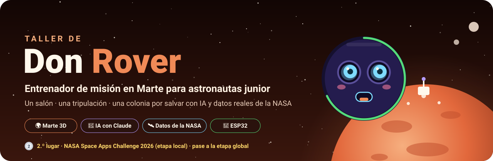</a>
</p>

<p align="center">
  <a href="https://tallerdedonrover.vercel.app"></a>
  
</p>

<p align="center">
  
  
  
  
  
  
  
  
  
  
</p>

<p align="center">
  <b>Un salón. Una tripulación. Una colonia en Marte por salvar.</b><br>
  Niñas y niños de 7 a 15 años dirigen una base en Marte desde su celular. Cada quien tiene una especialidad y un dato que nadie más tiene.
  <b>IX</b>, la IA de la colonia, arma las misiones con <b>datos reales de la NASA</b>, y <b>Don Rover</b>, un robot con pantalla redonda,
  narra la misión y responde sus preguntas en voz alta.
</p>

<p align="center">
  <a href="#premio">🏆 Premio</a> ·
  <a href="#que-es">✨ Qué es</a> ·
  <a href="#como-se-ve">📸 Cómo se ve</a> ·
  <a href="#como-funciona">🧭 Cómo funciona</a> ·
  <a href="#como-se-usa">🎮 Cómo se usa</a> ·
  <a href="#reto">🚀 El reto</a> ·
  <a href="#ciencia">🔬 Ciencia real</a> ·
  <a href="#hardware">🤖 Hardware</a> ·
  <a href="#desarrollo">🛠️ Desarrollo</a>
</p>

---

<a id="premio"></a>

## 🏆 Reconocimiento

<p align="center">
  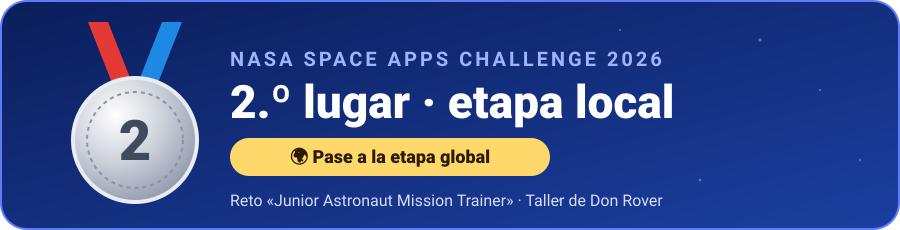
</p>

El **Taller de Don Rover** ganó el **2.º lugar** en la etapa local del **NASA Space Apps Challenge 2026** y obtuvo su **pase a la etapa global** con el reto **«Junior Astronaut Mission Trainer»**. El reto pide un juego o una app en el que estudiantes dirijan una base en la Luna o en Marte: tienen que equilibrar soporte vital, blindaje contra la radiación, energía y comida, y ver qué decisiones hacen que la misión triunfe o fracase.

<table>
  <tr>
    <td width="50%">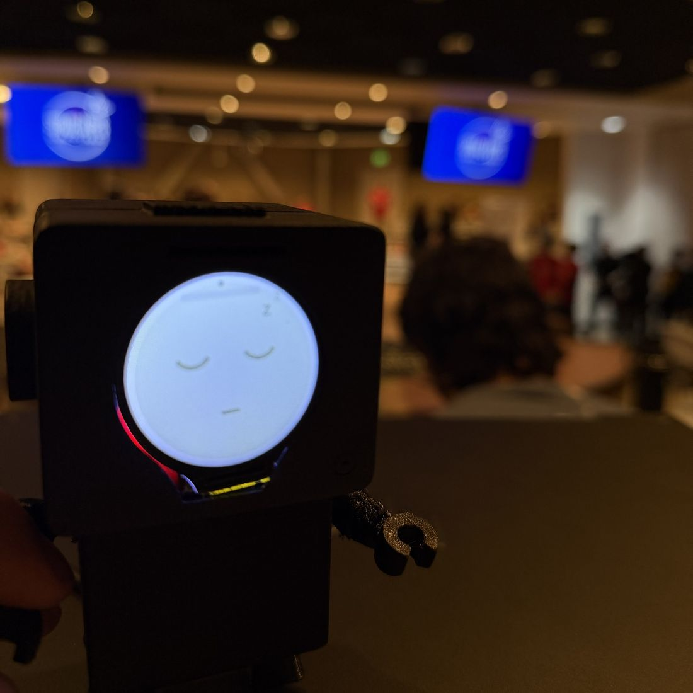</td>
    <td width="50%">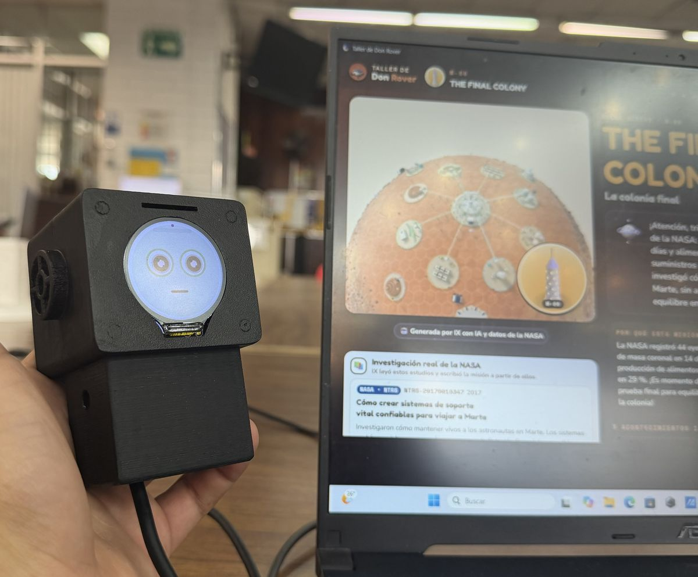</td>
  </tr>
  <tr>
    <td align="center"><sub>Don Rover en el evento de NASA Space Apps</sub></td>
    <td align="center"><sub>Don Rover junto a la consola del profe, con una misión generada por IX</sub></td>
  </tr>
  <tr>
    <td>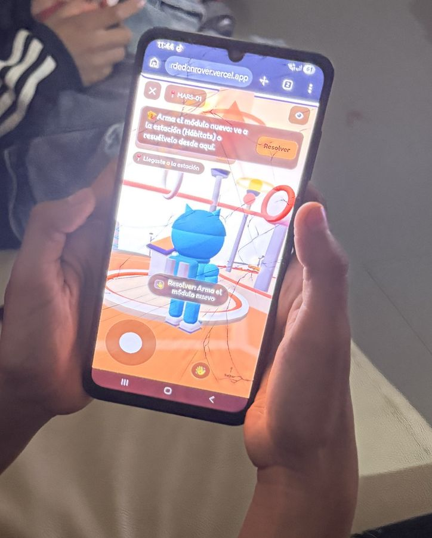</td>
    <td>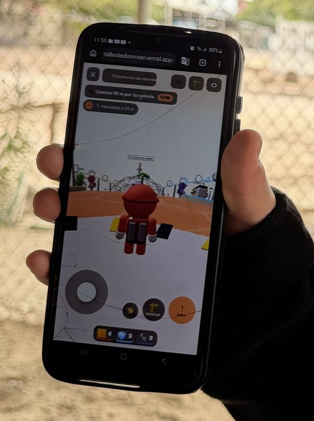</td>
  </tr>
  <tr>
    <td align="center"><sub>Alumnos probándolo: cada quien resuelve su estación en el Marte 3D</sub></td>
    <td align="center"><sub>Modo libre en el celular: recolectar recursos y construir la base</sub></td>
  </tr>
</table>

---

<a id="que-es"></a>

## ✨ ¿Qué es?

Es una **plataforma de aprendizaje multijugador construida alrededor de la IA**. Convierte el salón en una colonia en Marte que tiene que sobrevivir. Funciona en el navegador como **PWA**, así que no hay nada que instalar en los celulares.

<table>
  <tr>
    <td width="33%" valign="top">
      <h3>👩‍🏫 Para el profe</h3>
      Abre la colonia en el proyector y los alumnos escanean el QR. IX genera la misión con el clima espacial real y estudios de la NASA. El profe controla las fases, da pistas y descarga el reporte.
    </td>
    <td width="33%" valign="top">
      <h3>🧑‍🚀 Para los alumnos</h3>
      Arman su astronauta y entran al <b>Marte 3D</b> en su celular. <b>Minan</b> regolito, hielo y hematita, <b>fabrican</b> la pieza de su especialidad, combinan datos con su tripulación, votan y salvan la colonia en una emergencia. Con tiempo extra, juegan el <b>Torneo marciano</b> de todos contra todos.
    </td>
    <td width="33%" valign="top">
      <h3>🤖 Don Rover</h3>
      Un robot con pantalla redonda que <b>narra la misión</b>, dice las pistas y <b>responde preguntas por voz</b>. Su boca se mueve mientras la computadora habla. Sin robot, su cara aparece en la consola.
    </td>
  </tr>
  <tr>
    <td valign="top">
      <h3>🎓 Entrenador de misión</h3>
      Seis simuladores con <b>física real de Marte</b>: energía en una tormenta de polvo, oxígeno, agua, invernadero, radiación y aterrizaje. La IA elige el reto según lo que cada quien necesita practicar.
    </td>
    <td valign="top">
      <h3>🏗️ Modo libre</h3>
      Sin código de clase: explorar Marte, recolectar recursos y construir su propia base, <b>solos o con amigos</b> por enlace o QR.
    </td>
    <td valign="top">
      <h3>♿ Accesible</h3>
      Subtítulos grandes de todo lo que dice Don Rover, voz más lenta, preguntas por teclado, botón físico, controles táctiles grandes y respeto a <code>prefers-reduced-motion</code>.
    </td>
  </tr>
</table>

**Cuatro especialidades, conectadas como los sistemas de una base real.** Nadie tiene toda la información, así que la tripulación solo encuentra la mejor decisión si coopera.

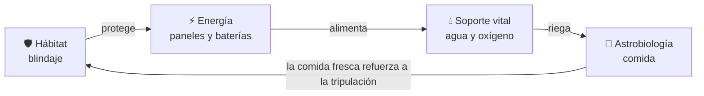

**Seis misiones:** 🌿 M-01 *Greenhouse Rescue* · 💧 M-02 *The Water Crisis* · 🌑 M-03 *Darkness Protocol* · 📡 M-04 *The Unknown Signal* · 🏠 M-05 *Habitat Zero* · 🏙️ M-06 *The Final Colony*.

---

<a id="como-se-ve"></a>

## 📸 Cómo se ve

<table>
  <tr>
    <td colspan="2">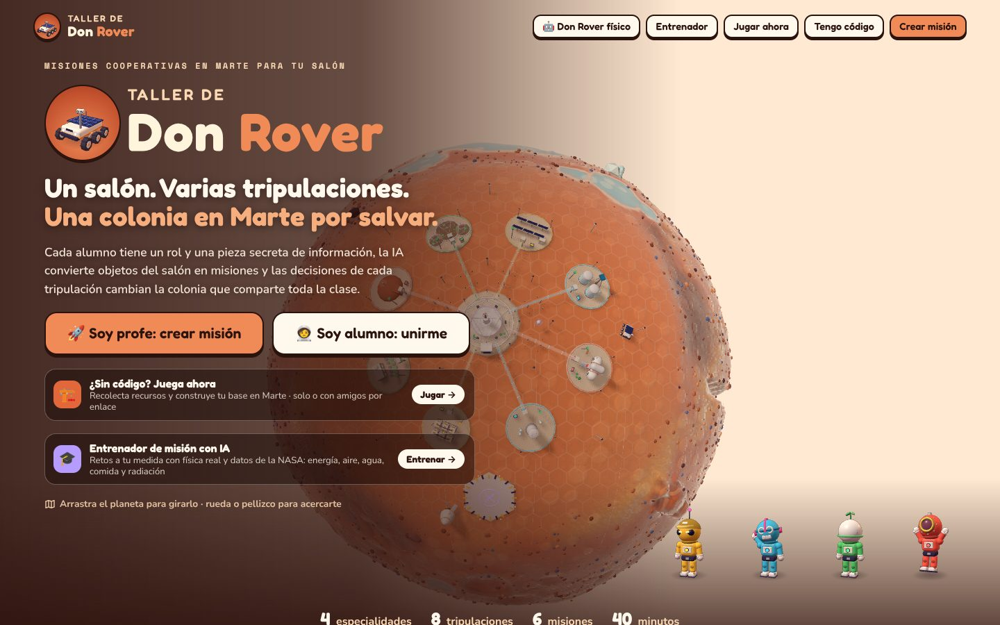</td>
  </tr>
  <tr>
    <td colspan="2" align="center"><sub><b>Portada:</b> el planeta y la colonia MARS-01 en 3D, todo generado por código (sin modelos externos)</sub></td>
  </tr>
  <tr>
    <td width="50%">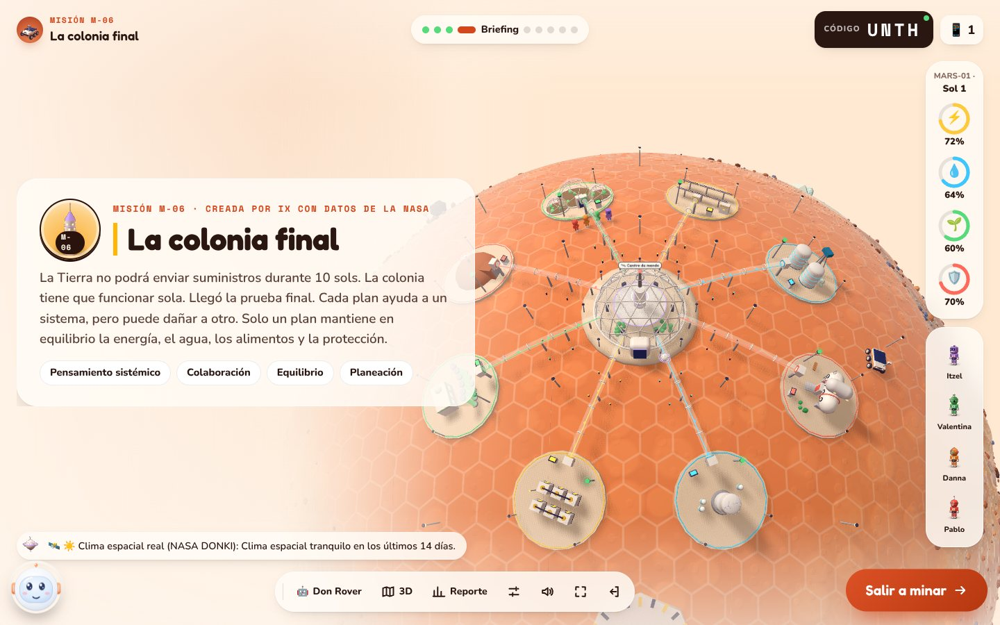</td>
    <td width="50%">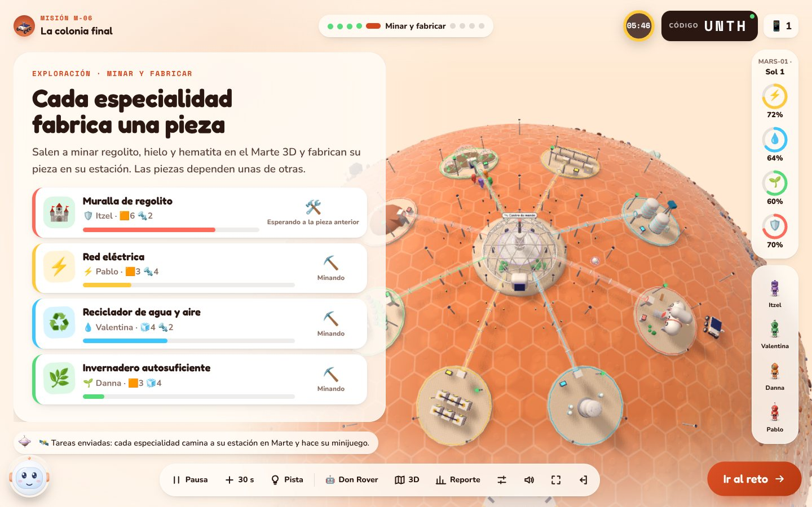</td>
  </tr>
  <tr>
    <td align="center"><sub><b>Briefing:</b> una sola tarjeta y el planeta 3D de fondo, que viaja a donde pasa la misión</sub></td>
    <td align="center"><sub><b>Minar y fabricar:</b> cada especialidad mina recursos de Marte y fabrica su pieza</sub></td>
  </tr>
  <tr>
    <td width="50%">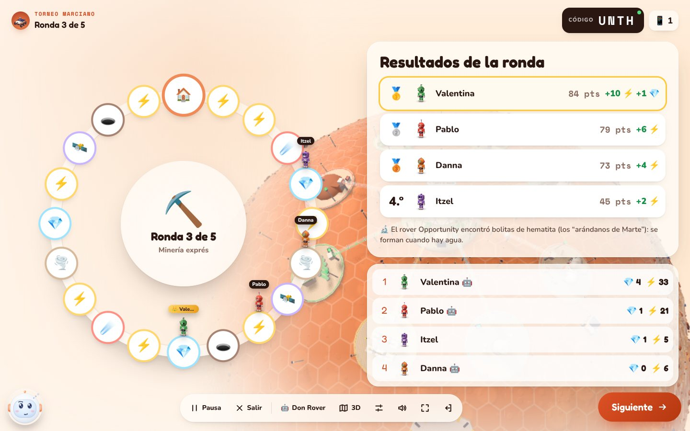</td>
    <td width="50%">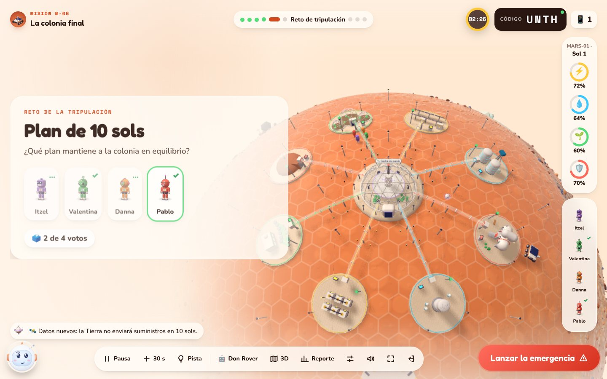</td>
  </tr>
  <tr>
    <td align="center"><sub><b>Torneo marciano:</b> minijuegos de todos contra todos y una pista con sorpresas</sub></td>
    <td align="center"><sub><b>Reto:</b> votan una decisión y Don Rover la narra con subtítulos</sub></td>
  </tr>
  <tr>
    <td>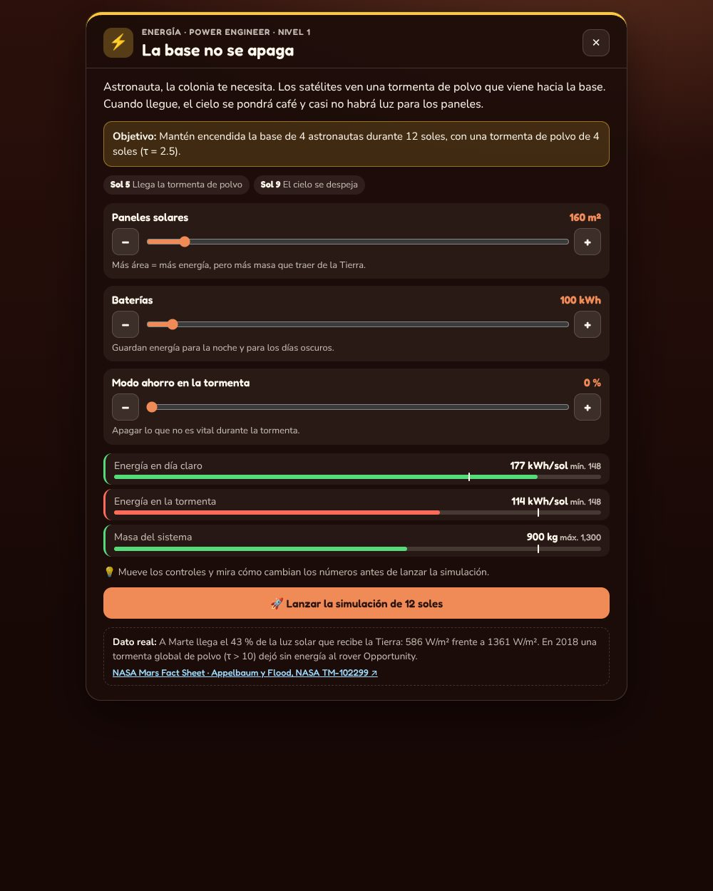</td>
    <td>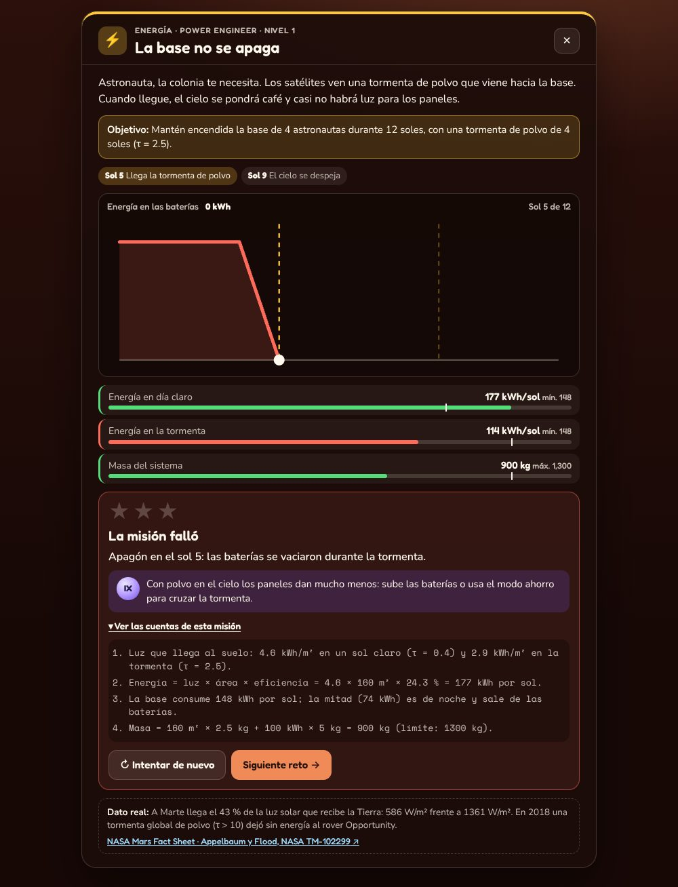</td>
  </tr>
  <tr>
    <td align="center"><sub><b>Entrenador · 1.</b> Decides cuántos paneles, baterías y ahorro llevar</sub></td>
    <td align="center"><sub><b>Entrenador · 2.</b> La misión corre sol por sol, falla en el sol 5 y muestra las cuentas</sub></td>
  </tr>
</table>

<table>
  <tr>
    <td width="25%">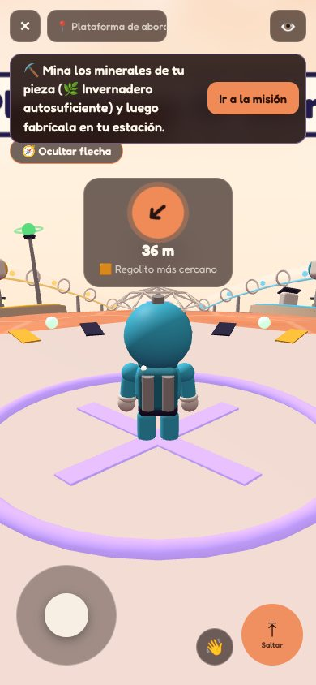</td>
    <td width="25%">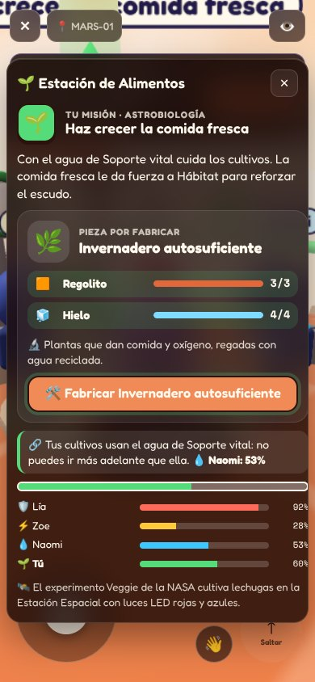</td>
    <td width="25%">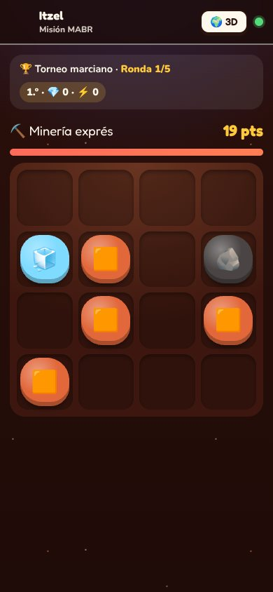</td>
    <td width="25%">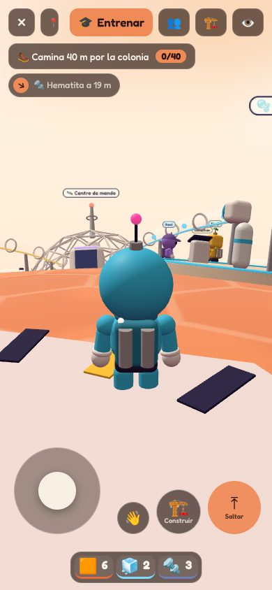</td>
  </tr>
  <tr>
    <td align="center"><sub><b>Minar</b> en el Marte 3D</sub></td>
    <td align="center"><sub><b>Fabricar</b> en la estación</sub></td>
    <td align="center"><sub><b>Torneo:</b> minería exprés</sub></td>
    <td align="center"><sub><b>Modo libre</b></sub></td>
  </tr>
</table>

<p align="center">
  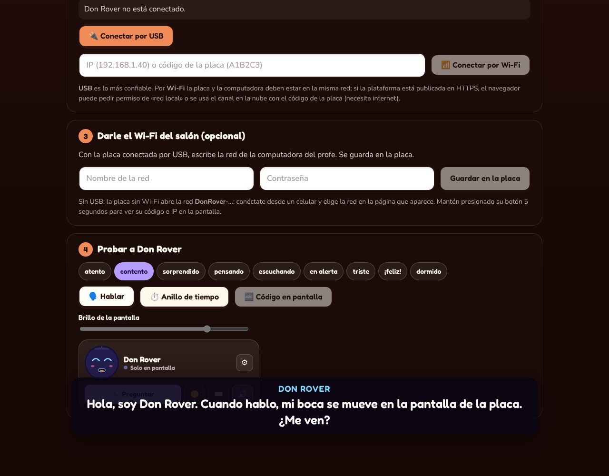<br>
  <sub><b>Don Rover físico:</b> conectar la placa, darle el Wi-Fi y probar sus caras</sub>
</p>

---

<a id="como-funciona"></a>

## 🧭 Cómo funciona

### El salón conectado

El navegador del profe, en el proyector, es el **anfitrión y la única fuente de verdad** del juego. Los celulares se conectan directo por **WebRTC** (y por Supabase Realtime si la red de la escuela lo bloquea) y Don Rover se conecta por **USB o Wi-Fi**. Las funciones en la nube (IA, NASA y base de datos) son **opcionales**: sin ellas, el juego sigue con su propio motor y su contenido.

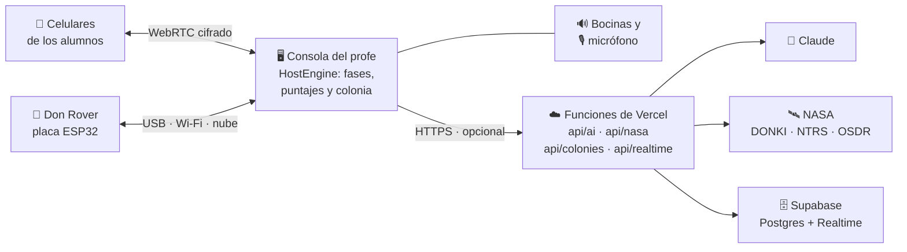

### «La IA narra, el motor decide»

Un **motor determinista** calcula los recursos, los puntajes y las consecuencias. Claude solo **elige entre opciones válidas y escribe**, con salidas estructuradas (JSON Schema) que se validan antes de usarse. Si la IA no está disponible, el motor usa sus plantillas y el juego nunca se detiene.

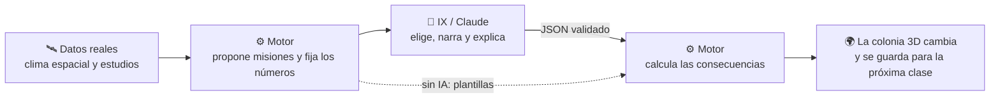

### Una misión, paso a paso

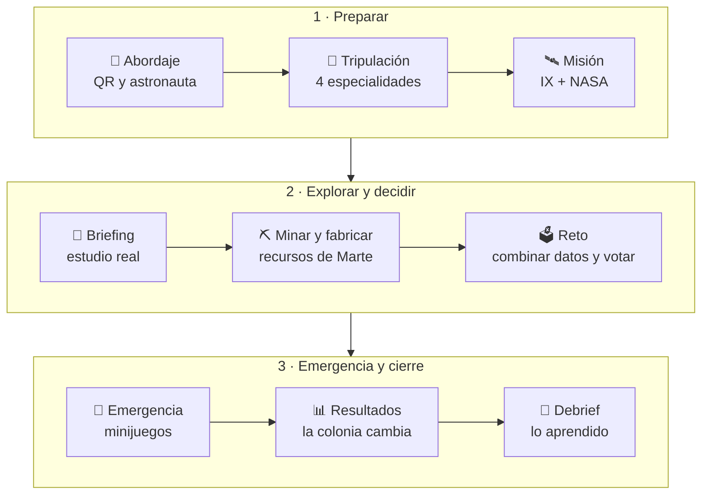

### ⛏️ Minar y fabricar con recursos de Marte

En la exploración, cada especialidad fabrica la pieza que resuelve su parte de la misión con lo que hay en el planeta. Es lo que la NASA llama **ISRU**: usar los recursos del lugar en vez de traerlos de la Tierra.

| Mineral | Dónde está | Por golpe de pico |
| --- | --- | :---: |
| 🟧 Regolito | El suelo suelto, en todas partes | 3 |
| 🧊 Hielo | Hielo enterrado, que brilla azul | 2 |
| 🔩 Hematita | Rocas oscuras de hierro, como las que encontró Opportunity | 2 |

1. **Minar:** el celular muestra la receta (por ejemplo, *Muralla de regolito* = 6 🟧 + 2 🔩) y una flecha hacia el depósito más cercano del mineral que falta.
2. **Fabricar:** con la receta completa, en su estación imprime la pieza en 3D.
3. **Las piezas dependen unas de otras:** el hábitat protege a la energía, la energía mueve el soporte vital y el agua llega al invernadero. El proyector muestra cada pieza: *Minando → Lista para fabricar → Instalada*.

Si el celular no puede mostrar 3D, se mina en un campo de rocas dentro de la misma tarjeta.

### 🏆 Torneo marciano (todos contra todos)

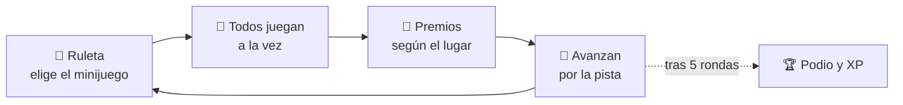

- **8 minijuegos:** dos propios del torneo, ⛏️ *Minería exprés* y 🚀 *Aterrizaje perfecto* (con la gravedad real de Marte, 3.721 m/s²), y seis de la colonia: 🧹 paneles, 💧 fugas, ☀️ seguir al Sol, 📡 señal, 🔌 cables y 📻 radio.
- **Premios por lugar:** energía ⚡ (10, 6, 4 y 2) y casillas para avanzar (5, 4, 3 y 2). Quien gana la ronda se lleva un cristal 💎.
- **La pista** rodea la colonia MARS-01 con 20 casillas: ⚡ celdas de energía, 💎 cristales de hielo, ☄️ meteoritos, 🌪️ tormentas de polvo, 🛰️ señales de satélite y 🕳️ tubos de lava que sirven de atajo. Pasar por la base da +5 ⚡.
- **Gana** quien junta más cristales (si empatan, más energía). Cada quien se lleva XP a su perfil según su lugar, y cada ronda cierra con un dato real de la NASA.

### Preguntarle algo a Don Rover

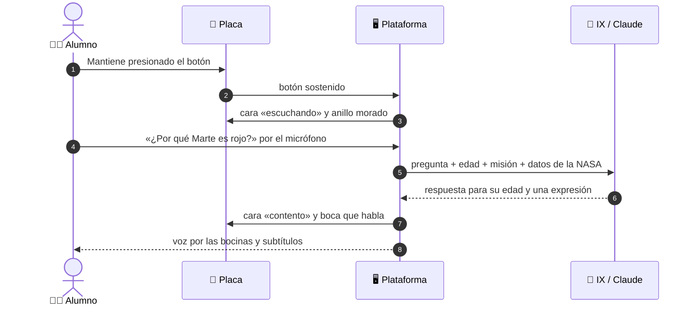

Además, **Don Rover flota en todas las secciones** de la plataforma: se le puede escribir o hablar, guarda la conversación y consulta datos reales de la NASA (clima espacial, asteroides cercanos, la foto del día y estudios científicos). En la consola del profe ocupa su lugar en la barra de abajo.

---

<a id="como-se-usa"></a>

## 🎮 Cómo se usa

> **Probar ya:** abre <https://tallerdedonrover.vercel.app> en la computadora del proyector. Para probar sin alumnos, elige el ritmo **Demo rápida** y usa **Completar con bots**.

### 👩‍🏫 El profe (de 10 a 40 minutos)

<p align="center">
  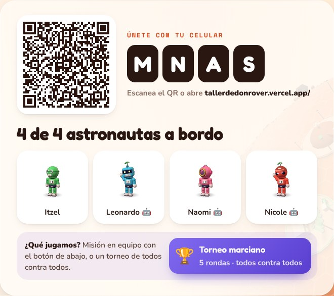
</p>

| Paso | Qué hacer |
| :---: | --- |
| **1** | Abre **Crear misión** (`#/profe`) y elige la dificultad (7–9, 10–12 o 12–15 años) y el ritmo (clase de 40 minutos o demo de 10). |
| **2** | Proyecta el **QR**: hasta **4 alumnos** entran con su celular. Si falta alguien, un bot de práctica ocupa su lugar y se lo cede cuando llega. |
| **3** | Presiona **Formar la tripulación** y **Generar la misión**: IX revisa el clima espacial real y la colonia, y escribe la misión. |
| **4** | Avanza las fases con el botón grande. Puedes pausar, dar **+30 s** o pedir una **Pista de IX**, y Don Rover la dice en voz alta. |
| **🏆** | ¿Sobra tiempo? Desde el abordaje abre el **Torneo marciano**: 5 rondas de minijuegos de todos contra todos. |

La consola muestra una sola tarjeta por etapa sobre el planeta 3D, que viaja a donde pasa la misión. En proyectores Full HD o más grandes, todo crece para leerse desde el fondo del salón.
| **5** | Al final, el **debrief** resume lo aprendido. Descarga el **reporte CSV**: la colonia queda guardada para la siguiente clase. |

### 🧑‍🚀 Los alumnos

1. Escanean el QR o escriben el código de 4 letras en `#/jugar`.
2. Arman su astronauta y entran al **Marte 3D** (joystick y botones grandes en el celular).
3. **Minan** regolito, hielo y hematita en el Marte 3D (una flecha los lleva al depósito que les falta) y **fabrican** en su estación la pieza de su especialidad. Al terminarla reciben un dato secreto.
4. Combinan sus datos, **votan** y escriben la bitácora. En la **emergencia**, cada especialidad juega su minijuego.
5. En el **Torneo marciano** todos juegan el mismo minijuego a la vez desde su celular y avanzan por la pista según su lugar.

### 🏗️ Sin código: modo libre, entrenador y Don Rover

| Ruta | Para qué |
| --- | --- |
| [`#/libre`](https://tallerdedonrover.vercel.app/#/libre) | Explorar, recolectar regolito, hielo y hematita, y construir módulos: paneles solares, baterías, extractor de hielo, generador de oxígeno, invernadero, hábitat y antena. **Solo o con amigos**: se comparte un enlace o un QR. |
| [`#/entrenador`](https://tallerdedonrover.vercel.app/#/entrenador) | Retos personalizados con física real; IX explica por qué falló o funcionó. También se abre desde el modo libre con el botón **Entrenar**. |
| [`#/donrover`](https://tallerdedonrover.vercel.app/#/donrover) | Instalar el firmware en la placa con un clic, conectarla por USB o Wi-Fi y probar caras, voz y micrófono. |
| [`#/mundo`](https://tallerdedonrover.vercel.app/#/mundo) · [`#/minijuegos`](https://tallerdedonrover.vercel.app/#/minijuegos) | El planeta 3D para recorrerlo libremente, y todos los minijuegos para probarlos sin una partida. |
| [`#/pitch`](https://tallerdedonrover.vercel.app/#/pitch) | La presentación del proyecto para el hackatón, con Don Rover, capturas, fotos de los talleres y datos reales de la NASA. |

---

<a id="reto"></a>

## 🚀 Cómo responde al reto «Junior Astronaut Mission Trainer»

| Lo que pide el reto | Cómo lo resuelve el Taller de Don Rover |
| --- | --- |
| Dirigir una **base en la Luna o en Marte** | La colonia **MARS-01** (8 sectores y edificios que se desbloquean), la base propia del modo libre y los simuladores del entrenador. |
| Equilibrar **soporte vital, blindaje, energía y comida** | Las **4 especialidades** son esos sistemas, conectados entre sí. Seis simuladores los entrenan uno por uno: ⚡ tormenta de polvo, 🫧 oxígeno, 💧 agua, 🌱 invernadero, 🛡️ radiación y 🚀 aterrizaje. |
| Ver qué decisiones hacen que la misión **triunfe o fracase** | El motor corre la misión **sol por sol** y dice en qué sol falló y por qué. La colonia 3D cambia con cada decisión y se guarda entre clases. |
| Para **estudiantes** | De 7 a 15 años, en español, sin cuentas y en celulares sencillos, con tres dificultades y un robot que explica en voz alta. |
| Con **datos de la NASA** | Clima espacial real (**DONKI**), estudios reales (**NTRS** y **OSDR**) y constantes de publicaciones de la NASA en cada simulador. |
| **Creativo y diferente** | Un robot físico que narra y responde preguntas, misiones que la IA escribe a partir de estudios reales y un Marte 3D multijugador. |

---

<a id="ciencia"></a>

## 🔬 Ciencia real en los simuladores

Cada simulador usa las mismas ecuaciones y números que publica la NASA (`shared/marsSim.ts`, con la fuente de cada constante). Son modelos simplificados para el salón, pero con **unidades y órdenes de magnitud reales**.

| Simulador | La física | Datos de |
| --- | --- | --- |
| ⚡ **Tormenta de polvo** | $`E = H(\phi, L_s, \tau) \cdot A \cdot \eta`$, y la luz cae con la opacidad del polvo: $`T(\tau) = e^{-0.21 \tau}`$ | NASA Mars Fact Sheet (586 W/m²) · Appelbaum y Flood (NASA TM-102299) |
| 🫧 **Fábrica de aire** | MOXIE: 10 g de O₂ por hora con ~300 W · electrólisis: 0.888 kg de O₂ por litro de agua y 6.6 kWh por kg | MOXIE en Perseverance (Hoffman et al., 2022) · BVAD: 0.84 kg de O₂ por persona al día |
| 💧 **Minería de hielo** | $`Q = m (c_{hielo} \Delta T + L_f + c_{agua} \Delta T)`$ y reciclaje de hasta 98 % | Phoenix Mars Lander · ECLSS de la Estación Espacial |
| 🌱 **Invernadero** | $`\text{cosecha} = A \cdot Y \cdot \min(1, DLI / DLI_{sat})`$, en kcal | Cámara de producción de biomasa del Centro Kennedy (Wheeler et al.) |
| 🛡️ **Escudo de regolito** | $`D = D_0 e^{-x/\lambda}`$ con $`D_0 = 0.64`$ mSv por día | MSL/RAD del rover Curiosity (Hassler et al., 2014) · NASA-STD-3001 |
| 🚀 **Aterrizaje** | $`a = F/m - g_{Marte}`$ y $`\dot{m} = F / (I_{sp} g_0)`$, con $`g_{Marte} = 3.721`$ m/s² | Entrada, descenso y aterrizaje de Perseverance |

**Todos los retos tienen solución.** Se comprobó con 1,080 escenarios (6 simuladores × 3 niveles × 60 semillas), recorriendo las combinaciones de los controles; el aterrizaje se probó con un piloto automático. En todos se puede ganar, y en casi todos con tres estrellas.

---

<a id="hardware"></a>

## 🤖 Hardware: Don Rover físico

<table>
  <tr>
    <td width="42%">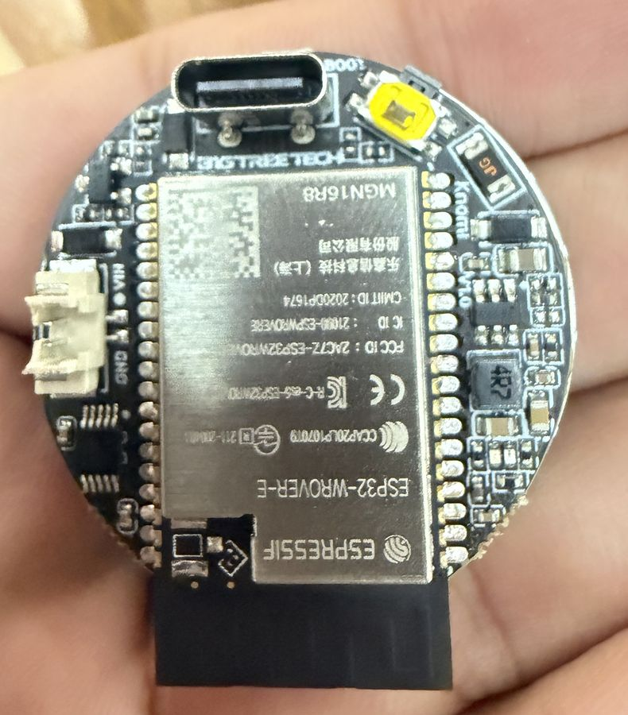</td>
    <td valign="top">
      La placa <b>no tiene micrófono ni bocina</b>. La computadora del profe habla y escucha, y la placa muestra la cara de Don Rover: mueve la boca mientras habla, cambia de expresión según la misión, muestra el código de la sala y dibuja el tiempo que queda como un anillo.
      <br><br>
      <b>Su botón:</b> un toque corto repite lo último · sostenido escucha una pregunta · 5 segundos muestra su código y su IP.
      <br><br>
      <b>Caras:</b> atento · contento · sorprendido · pensando · escuchando · en alerta · triste · ¡feliz! · dormido.
    </td>
  </tr>
</table>

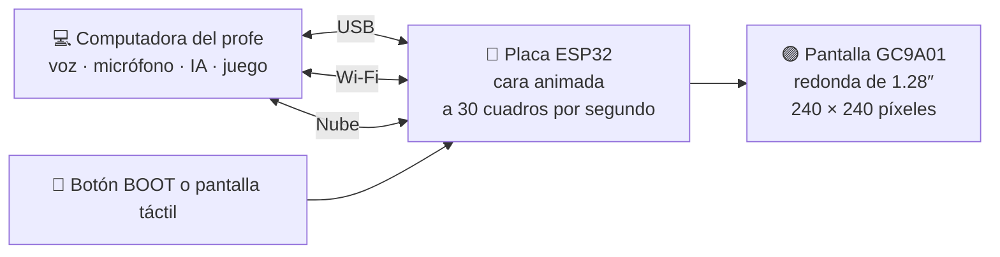

**Tres formas de conectarla:** **USB** con Web Serial (la más confiable) · **Wi-Fi** en la misma red (`ws://<ip>:81` o `POST /cmd`) · **Nube** con el canal `donrover-bot-<código>` de Supabase, para cuando la plataforma publicada en HTTPS no puede hablar con la red local.

### Placas compatibles

Todas usan la misma pantalla redonda **GC9A01** y el mismo firmware, con un entorno de PlatformIO por placa. Elige la que tengas a la mano:

| Placa | Chip | Pantalla | Cables | PSRAM | Costo | Entorno |
| --- | --- | --- | :---: | :---: | :---: | --- |
| **BIGTREETECH KNOMI v1** | ESP32-WROVER-E | integrada | **0** | 8 MB | 💲💲💲 | `knomi` |
| **ESP32-2424S012** | ESP32-C3 | integrada y **táctil** | **0** | — | 💲💲 | `esp32c3-round` |
| **ESP32 DevKit V1** + módulo GC9A01 | ESP32 | módulo de 1.28″ | 8 | — | 💲 | `esp32-devkit` |
| **ESP32-C3 SuperMini** + módulo GC9A01 | ESP32-C3 | módulo de 1.28″ | 8 | — | 💲 (la más barata) | `esp32c3-mini` |
| **ESP32-S3 DevKitC N16R8** + módulo GC9A01 | ESP32-S3 | módulo de 1.28″ | 8 | 8 MB | 💲💲 | `esp32s3-n16r8` |

<sub>Con PSRAM, la cara usa colores de 16 bits y la conexión por la nube tiene memoria de sobra. Sin PSRAM, el firmware elige entre 16 bits y 256 colores según la memoria libre.</sub>

### Diagramas de conexión

<details open>
<summary><b>BIGTREETECH KNOMI v1</b> · sin cables</summary>
<br>
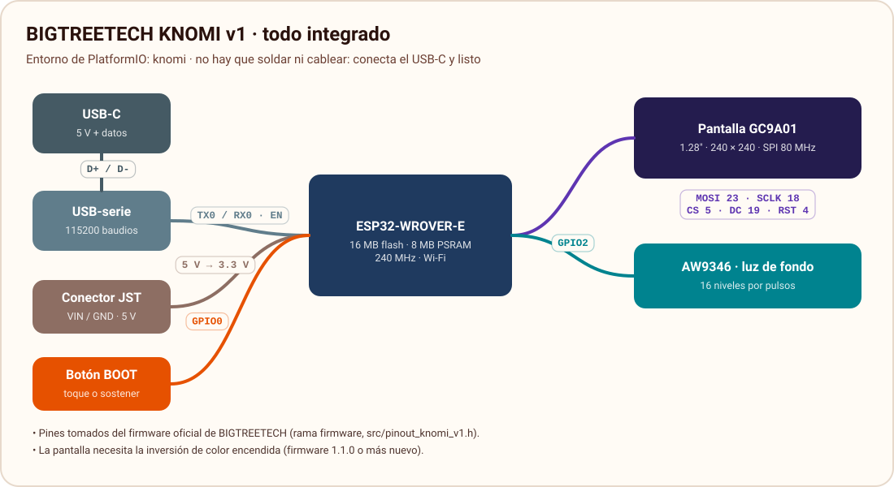
</details>

<details>
<summary><b>ESP32-2424S012</b> (ESP32-C3 con pantalla redonda táctil) · sin cables</summary>
<br>
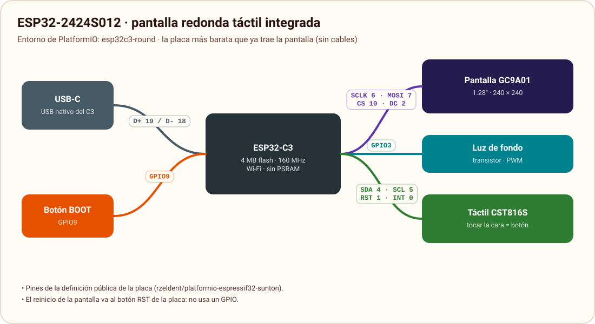
</details>

<details open>
<summary><b>ESP32 DevKit V1 + GC9A01</b> · 8 cables</summary>
<br>
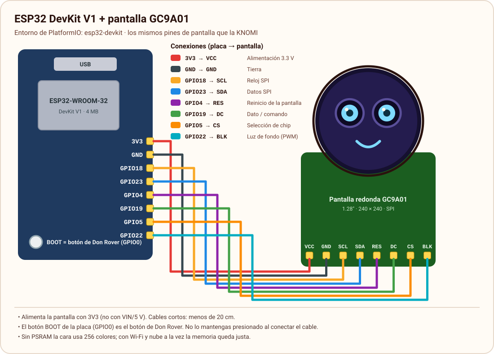
</details>

<details>
<summary><b>ESP32-C3 SuperMini + GC9A01</b> · 8 cables</summary>
<br>
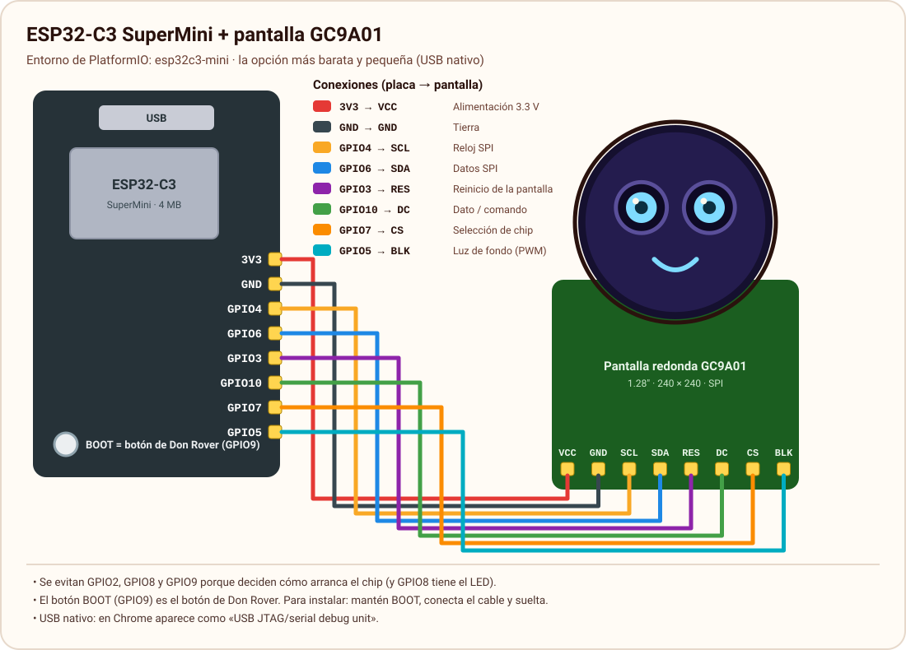
</details>

<details>
<summary><b>ESP32-S3 DevKitC N16R8 + GC9A01</b> · 8 cables</summary>
<br>
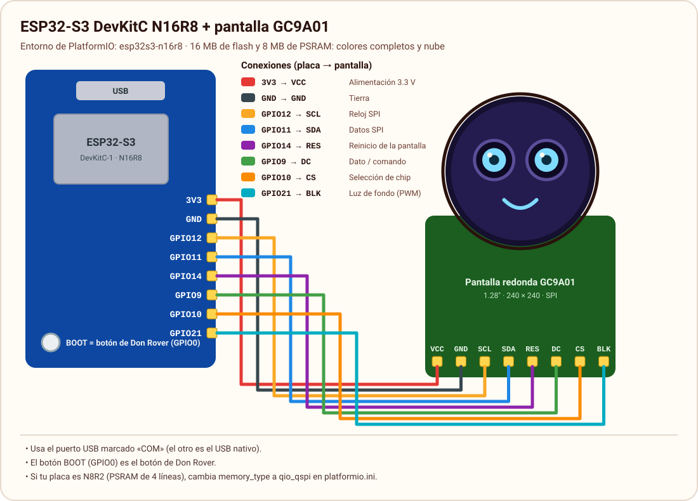
</details>

**Tabla rápida de pines (GPIO)**

| Señal | Módulo | KNOMI v1 | 2424S012 | DevKit V1 | C3 SuperMini | S3 N16R8 |
| --- | :---: | :---: | :---: | :---: | :---: | :---: |
| Alimentación | VCC | — | — | 3V3 | 3V3 | 3V3 |
| Tierra | GND | — | — | GND | GND | GND |
| Reloj SPI | SCL / CLK | 18 | 6 | 18 | 4 | 12 |
| Datos SPI | SDA / DIN | 23 | 7 | 23 | 6 | 11 |
| Selección | CS | 5 | 10 | 5 | 7 | 10 |
| Dato / comando | DC | 19 | 2 | 19 | 10 | 9 |
| Reinicio | RES / RST | 4 | RST de la placa | 4 | 3 | 14 |
| Luz de fondo | BLK / BL | 2 (AW9346) | 3 | 22 | 5 | 21 |
| Botón de Don Rover | — | BOOT (0) | BOOT (9) y táctil | BOOT (0) | BOOT (9) | BOOT (0) |

**Lista de compras (versión con módulo):** una placa de la tabla · un módulo **GC9A01 de 1.28″** con pines VCC, GND, SCL, SDA, RES, DC, CS y BLK · 8 cables hembra-hembra · un cable USB **de datos**. Opcional: una carcasa impresa en 3D como la de las fotos.

### 🔋 Don Rover portátil: batería, micrófono y bocina

La KNOMI es el camino más rápido porque viene armada. Si prefieres **construir a Don Rover desde cero** y que sea portátil, este diseño usa un **ESP32-DevKitC** (programado con Arduino), la **pantalla redonda**, un **micrófono**, una **bocina** y una **batería**. Las imágenes son diagramas ilustrados y están en [`docs/hardware/`](docs/hardware/).

<p align="center">
  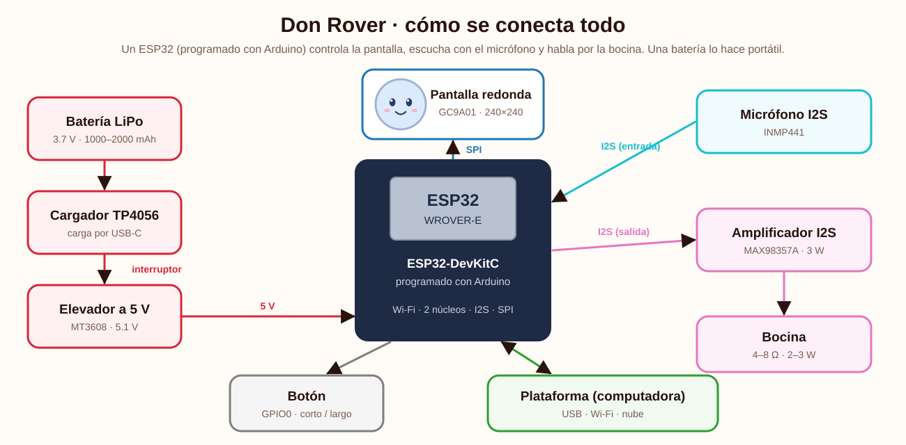
</p>

<details>
<summary><b>🧾 Materiales</b></summary>
<br>

| Cant. | Componente | Para qué sirve | Nota |
| :---: | --- | --- | --- |
| 1 | **ESP32-DevKitC de 38 pines**; ideal la **ESP32-DevKitC-VE** (módulo WROVER-E con PSRAM) | El cerebro: Wi-Fi, pantalla y audio | Sin PSRAM (módulo WROOM) también funciona. |
| 1 | **Pantalla redonda GC9A01** 1.28" 240×240 (SPI) | La cara de Don Rover | Funciona a 3.3 V |
| 1 | **Micrófono I2S INMP441** | Escuchar preguntas | Funciona a 3.3 V |
| 1 | **Amplificador I2S MAX98357A** | Hablar | Funciona a 5 V; da hasta 3 W |
| 1 | **Bocina** de 4–8 Ω y 2–3 W (≈ 40 mm) | El sonido | |
| 1 | **Batería LiPo** 3.7 V de 1 celda, 1000–2000 mAh, **con protección** | Que sea portátil | Con conector JST |
| 1 | **Cargador TP4056 USB-C** con protección (DW01) | Cargar la batería | |
| 1 | **Elevador MT3608** ajustado a 5.1 V (o un módulo fijo de 5 V y 1 A o más) | Subir de 3.7 V a 5 V | |
| 1 | **Diodo Schottky** SS14 o 1N5817 | Evita que el USB del ESP32 alimente al elevador | |
| 1 | **Interruptor** deslizable | Encender y apagar | |
| 1 | **Botón** pulsador | Corto: repetir · largo: preguntar | |
| 2 + 1 | **Resistencias de 100 kΩ** y **capacitor de 100 nF** | Medir la carga de la batería | |
| 1 | **Capacitor electrolítico** de 470 µF y 10 V | Estabiliza los 5 V del amplificador | |
| — | Cables, protoboard o placa perforada y carcasa (impresa en 3D o una caja) | | |

</details>

<details open>
<summary><b>🔌 Diagrama de conexiones</b></summary>
<br>

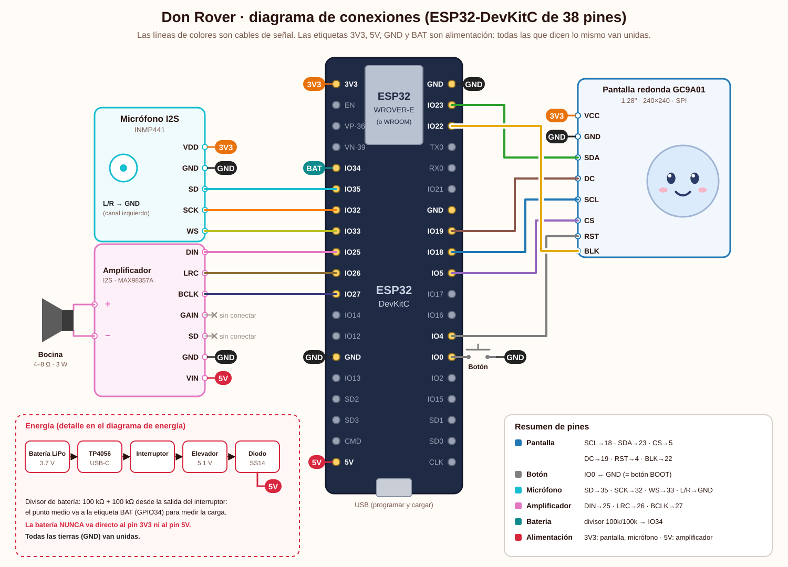

| Módulo | Pin del módulo | Va al ESP32 |
| --- | --- | --- |
| **Pantalla GC9A01** | VCC · GND | 3V3 · GND |
| | SCL · SDA | GPIO18 · GPIO23 |
| | CS · DC · RST | GPIO5 · GPIO19 · GPIO4 |
| | BLK (luz de la pantalla) | GPIO22 |
| **Botón** | un lado · el otro | GPIO0 · GND (es el mismo pin que el botón BOOT de la placa) |
| **Micrófono INMP441** | VDD · GND · L/R | 3V3 · GND · GND (canal izquierdo) |
| | SD · SCK · WS | GPIO35 · GPIO32 · GPIO33 |
| **Amplificador MAX98357A** | VIN · GND | 5V · GND |
| | DIN · LRC · BCLK | GPIO25 · GPIO26 · GPIO27 |
| | GAIN · SD | sin conectar (9 dB y canal mixto) |
| **Bocina** | + · − | + y − del MAX98357A (**ninguno va a GND**) |
| **Batería** | punto medio del divisor 100k/100k | GPIO34 (lectura analógica, ADC1) |

- La pantalla y el botón usan **los mismos pines que el entorno `esp32-devkit`** del firmware, así que se instala sin cambiar el código.
- La luz de la pantalla va a **GPIO22** y no a GPIO2: GPIO2 es un pin de arranque y, si la pantalla lo deja en alto, la placa puede no entrar al modo de programación.
- El orden de los pines de la pantalla cambia según el fabricante: **guíate por el nombre impreso**, no por la posición.
- Mantén cortos los cables de la pantalla (menos de 10 cm), porque el bus SPI es rápido.
- GPIO34 y GPIO35 solo pueden leer. Por eso se usan para el micrófono (SD) y la batería.

</details>

<details>
<summary><b>🔋 Energía con batería</b></summary>
<br>

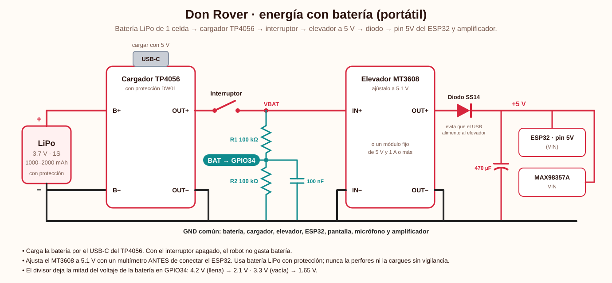

1. La batería se conecta a **B+ y B−** del TP4056. El robot se carga por el **USB-C del cargador**.
2. **OUT+** pasa por el **interruptor** y llega al **elevador MT3608**.
3. **Antes de conectar el ESP32**, gira el tornillo del MT3608 hasta que el multímetro marque **5.1 V** en su salida.
4. La salida del elevador pasa por el **diodo SS14** y va al pin **5V del ESP32** y al **VIN del amplificador**. El diodo evita que, cuando conectes el ESP32 por USB para programarlo, la corriente regrese al elevador.
5. El **divisor de 100 kΩ + 100 kΩ** deja la mitad del voltaje de la batería en **GPIO34** (4.2 V llena → 2.1 V · 3.3 V vacía → 1.65 V), así se puede mostrar el nivel de batería.
6. **Todas las tierras (GND) van unidas.**

**Seguridad:** usa baterías LiPo **con protección**; nunca las perfores, las dobles ni las cargues sin vigilancia. **La batería nunca va directo** al pin 3V3 ni al 5V del ESP32: siempre pasa por el cargador, el elevador y el diodo. Ajusta el MT3608 a 5.1 V **antes** de conectarlo. Si mantienes el botón (GPIO0) presionado al encender, entra a modo programación: es normal.

</details>

<details>
<summary><b>🛠️ Cómo queda armado, programarlo y probarlo</b></summary>
<br>

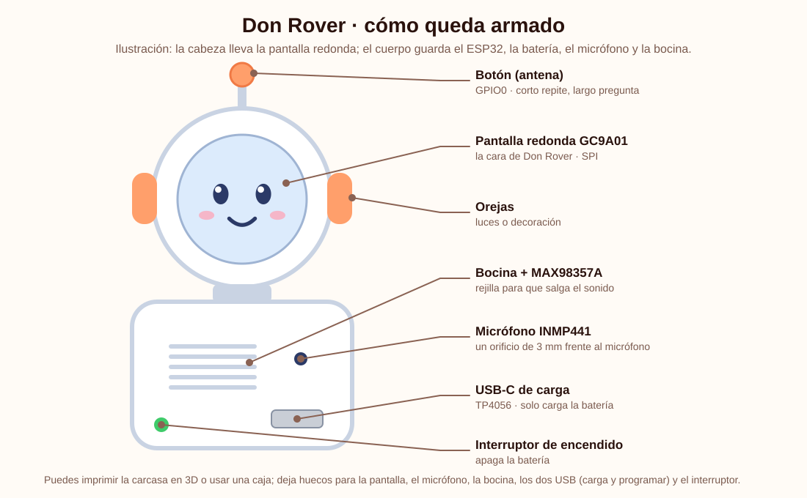

**Programarlo:** usa el mismo firmware que la placa **ESP32 DevKit V1 + módulo GC9A01** (el chip es el mismo). Desde el navegador: [`#/donrover`](https://tallerdedonrover.vercel.app/#/donrover) → elige esa placa → **Instalar en la placa**. Con PlatformIO (el firmware usa el framework de Arduino):

```bash
cd firmware/donrover-knomi
pio run -e esp32-devkit -t upload
pio device monitor
```

Con el **IDE de Arduino**: placa «ESP32 Dev Module», PSRAM «Enabled» si tu placa es WROVER, particiones «Huge APP» y las librerías **TFT_eSPI**, **ArduinoJson 7** y **WebSockets** (Markus Sattler). En el `User_Setup.h` de TFT_eSPI copia los `#define` de la pantalla del entorno `esp32-devkit` de `platformio.ini` (`GC9A01_DRIVER`, `TFT_MOSI 23`, `TFT_SCLK 18`, `TFT_CS 5`, `TFT_DC 19`, `TFT_RST 4`) y define `PIN_BACKLIGHT 22` y `PIN_BUTTON 0`. Si la pantalla muestra rayas con cables largos, baja `SPI_FREQUENCY` a 40 MHz.

**Micrófono y bocina:** hoy Don Rover **habla y escucha con la computadora del profe** y la placa mueve la cara y la boca. Con este diagrama el micrófono y la bocina **ya quedan conectados por I2S**, listos para que la siguiente versión del firmware hable y escuche por sí misma:

```cpp
// Pines I2S del Don Rover portátil (para la siguiente versión del firmware)
#define I2S_MIC_SCK   32   // INMP441 SCK
#define I2S_MIC_WS    33   // INMP441 WS
#define I2S_MIC_SD    35   // INMP441 SD (solo entrada)
#define I2S_SPK_BCLK  27   // MAX98357A BCLK
#define I2S_SPK_LRC   26   // MAX98357A LRC
#define I2S_SPK_DIN   25   // MAX98357A DIN
#define PIN_BATTERY   34   // divisor 100k/100k (ADC1)
```

**Prueba rápida:**

1. **Sin batería**, conecta el ESP32 por USB e instala el firmware. La pantalla muestra la cara de Don Rover y «¡Hola!».
2. En **Don Rover físico** (`#/donrover`) presiona **Conectar por USB**: debe aparecer «Don Rover conectado».
3. Presiona el botón: el **toque corto** repite lo último y el **sostenido** le hace una pregunta.
4. Con el interruptor apagado, conecta la batería, el cargador y el elevador ya ajustado. Desconecta el USB, enciende el interruptor y Don Rover debe arrancar solo con la batería.

</details>

### Instalar el firmware

| Forma | Cómo |
| --- | --- |
| 🌐 **Navegador** (recomendado) | Chrome o Edge → [`#/donrover`](https://tallerdedonrover.vercel.app/#/donrover) → elige tu placa → **Instalar en la placa**. Si no entra al modo de carga, usa **Reintentar en modo manual (BOOT)**. |
| 🪟 **Windows** | `powershell -ExecutionPolicy Bypass -File firmware\donrover-knomi\flash.ps1 -Board knomi` |
| 🍎🐧 **macOS o Linux** | `./firmware/donrover-knomi/flash.sh knomi` |
| 🧩 **PlatformIO** | `cd firmware/donrover-knomi && pio run -e knomi -t upload` |
| ⌨️ **Solo esptool** | `python -m esptool --baud 230400 write_flash -z 0x0 donrover-knomi.bin` (imágenes en `https://tallerdedonrover.vercel.app/firmware/`) |

Cambia `knomi` por el entorno de tu placa: `esp32c3-round`, `esp32-devkit`, `esp32c3-mini` o `esp32s3-n16r8`. Los scripts solo necesitan Python 3, detectan el chip y el puerto solos y, si no encuentran la imagen en el repositorio, la descargan de la plataforma publicada.

<details>
<summary><b>🧰 Solución de problemas</b></summary>
<br>

| Problema | Solución |
| --- | --- |
| La cara se ve **clara, con ojos cafés** | Los colores están invertidos: instala el firmware **1.1.0** o usa **🎨 Invertir colores** en `#/donrover` (se guarda en la placa). |
| La placa **no aparece** en la lista de puertos | Usa un cable **de datos** (no solo de carga) e instala el controlador USB de tu placa (CH340 o CP210x). Las placas con ESP32-C3 aparecen como «USB JTAG/serial debug unit». |
| «**No entró al modo de carga**» | Mantén presionado **BOOT**, desconecta y vuelve a conectar el cable, suelta el botón e instala de nuevo. |
| «**El puerto está ocupado**» | Cierra las otras pestañas de la plataforma (la consola se conecta sola a la placa) y programas como Arduino IDE o un monitor serie. |
| **Pantalla negra** en un módulo suelto | Revisa que VCC vaya a **3V3**, y revisa GND y BLK. Compara el cableado con el diagrama de tu placa. |
| **No conecta por Wi-Fi** desde la página publicada | Las páginas HTTPS no siempre pueden hablar con la red local. Usa USB o el **código de 6 caracteres** de la placa (canal en la nube; necesita Supabase configurado). |

</details>

Detalles del firmware, protocolo JSON y estructura en [`firmware/donrover-knomi/README.md`](firmware/donrover-knomi/README.md).

---

<a id="desarrollo"></a>

## 🛠️ Para desarrolladores

Requisitos: **Node.js 20 o más reciente** y npm.

```bash
npm install
npm run dev          # http://localhost:5173/#/profe (también monta las funciones de api/)
```

Sin alumnos, agrega **bots de práctica** desde la barra inferior para ver la misión completa. `npm run dev` lee las claves de `.env.local` (ver [`.env.example`](.env.example)).

> Los celulares no pueden abrir `localhost`: usa la dirección `Network` que muestra Vite (el servidor escucha en `host: true`) o la versión publicada. La cámara y la instalación como app requieren HTTPS.

| Script | Qué hace |
| --- | --- |
| `npm run dev` | Servidor de desarrollo de Vite (puerto 5173) con las funciones `api/` |
| `npm run build` | Build de producción en `dist/`, con el service worker generado |
| `npm run preview` | Sirve el build (puerto 4173) |
| `npm run typecheck` | `tsc --noEmit` del cliente y de `api/` (dos `tsconfig`) |
| `npm run icons` | Regenera los íconos PNG de la PWA desde SVG con resvg |
| `pio run` (en `firmware/donrover-knomi`) | Compila el firmware de las 5 placas y publica las imágenes en `public/firmware/` |
| `python3 docs/tools/diagramas.py` | Regenera los diagramas de conexión de este README |

Configuración de TypeScript: `target` ES2022, `moduleResolution: bundler`, `jsx: react-jsx` y `strict`. `tsconfig.json` cubre `src`, `shared` y `vite.config.ts`; `api/tsconfig.json` cubre las funciones.

<details>
<summary><b>🧱 Stack tecnológico</b></summary>
<br>

| Lenguaje | Uso |
| --- | --- |
| **TypeScript** (`strict`, ES2022) | Cliente (`src/`), contenido compartido (`shared/`) y funciones serverless (`api/`) |
| **TSX / JSX** | Componentes de React |
| **GLSL** | Shaders del terreno y del postproceso, inyectados en materiales de Three.js (`src/world/planet/terrainMaterial.ts`, `src/world/fx/PostFX.ts`) |
| **CSS** | Hojas propias por área (`src/styles/*.css`) con variables CSS; sin framework de estilos |
| **SQL** (PostgreSQL) | Esquema de Supabase (`supabase/schema.sql`) |
| **JavaScript** (ESM) | Plantilla del service worker (`pwa/sw.js`) y script de íconos (`scripts/make-icons.mjs`) |
| **C++** (Arduino) | Firmware de Don Rover (`firmware/donrover-knomi/src/`) |
| **Python** | Unir las imágenes del firmware (`merge_bin.py`) y generar los diagramas (`docs/tools/diagramas.py`) |

**Dependencias de producción**

| Paquete | Versión | Para qué |
| --- | --- | --- |
| `react`, `react-dom` | ^19.3.1 | Interfaz |
| `three` | ^0.187.0 | Planeta, colonia, astronautas y retratos 3D |
| `peerjs` | ^1.5.5 | WebRTC entre el proyector y los celulares, y entre amigos en el modo libre |
| `@supabase/realtime-js` | ^2.118.0 | Canal de respaldo y canal en la nube de Don Rover |
| `@anthropic-ai/sdk` | ^1.8.0 | Claude en el servidor (`api/ai.ts`) y, como alternativa, en el navegador |
| `postgres` | ^3.4.9 | Driver de Postgres para Supabase en `api/colonies.ts` |
| `qrcode` | ^1.5.4 | QR de abordaje y de las salas del modo libre |
| `esptool-js` | ^0.5.4 | Instalar el firmware de Don Rover desde el navegador (Web Serial) |
| `@fontsource-variable/fredoka`, `@fontsource-variable/nunito`, `@fontsource/space-mono` | ^5.3.0 | Tipografías locales para funcionar sin conexión |

**Dependencias de desarrollo:** `vite` ^8.3.8 · `@vitejs/plugin-react` ^6.3.0 · `typescript` ^7.0.2 · `@types/*` (node, react, react-dom, three, qrcode, w3c-web-serial) · `@resvg/resvg-js` ^2.6.2 (íconos de la PWA).

**Firmware:** PlatformIO (`espressif32@6.9.0`, Arduino) · `TFT_eSPI` 2.5.43 · `WebSockets` 2.6.1 · `ArduinoJson` 7.

| Servicio externo (todos opcionales) | Uso |
| --- | --- |
| **Vercel** | Hosting estático y funciones serverless (`api/*.ts`) |
| **Anthropic Claude API** (`claude-opus-5-5`) | Misión, narrativa, bitácoras, debrief, entrenador y preguntas a Don Rover |
| **Supabase** (Postgres + Realtime) | Colonias en la nube con historial, canal de respaldo y canal de Don Rover |
| **NASA**: DONKI (`api.nasa.gov`), NTRS (`ntrs.nasa.gov`), OSDR (`osdr.nasa.gov`) | Clima espacial y estudios científicos reales |
| **PeerJS Cloud** (o un PeerServer propio) | Solo la señalización inicial de WebRTC |
| **STUN** de Cloudflare y Google | Descubrir la ruta de red entre dispositivos |

</details>

<details>
<summary><b>🏛️ Principios de diseño</b></summary>
<br>

- **«La IA narra, el motor decide».** Recursos, puntajes y consecuencias los calcula un motor determinista. Claude solo escribe textos y elige entre opciones válidas, siempre con salidas estructuradas (JSON Schema) que se validan antes de usarse.
- **El proyector es el servidor.** No hay un backend que mantenga la partida: `HostEngine` corre en el navegador del profe, los celulares solo mandan acciones (`PlayerAction`) y reciben su vista filtrada (`PlayerView`).
- **Todo es opcional y tolerante a fallas.** Sin internet, sin IA, sin base de datos o sin la NASA, el juego usa plantillas, reglas del motor, contenido propio y `localStorage`.
- **Nadie tiene toda la información.** Los rompecabezas (`shared/puzzles.ts`) reparten un dato imprescindible a cada especialidad. Los números se generan con una semilla por tripulación (`shared/rng.ts`), así que copiar a otro equipo no sirve.

| Rol (`RoleId`) | Especialidad | Sistema de la colonia (`SystemId`) |
| --- | --- | --- |
| `power` | ⚡ Energía | `energy` |
| `life` | 💧 Soporte vital | `water` (agua y oxígeno) |
| `bio` | 🌱 Astrobiología | `food` |
| `habitat` | 🛡️ Hábitat | `habitat` |

</details>

<details>
<summary><b>🗺️ Rutas de la app</b></summary>
<br>

El enrutador usa el hash de la URL (`src/lib/route.ts`), así que funciona en cualquier hosting estático y dentro de la PWA instalada. Cada página se carga bajo demanda con `React.lazy` (`src/App.tsx`).

| Ruta | Componente | Parámetros |
| --- | --- | --- |
| `#/` | `pages/Landing.tsx` | — |
| `#/profe` | `pages/host/HostApp.tsx` | — |
| `#/jugar` | `pages/play/PlayApp.tsx` | `c` = código de sala (4 letras) · `s` = servidor de señalización propio (base64) |
| `#/libre` | `pages/free/FreePlay.tsx` | `sala` = código de sala (5 caracteres) · `modo` |
| `#/entrenador` | `pages/trainer/Trainer.tsx` | — |
| `#/donrover` | `pages/rover/RoverSetup.tsx` | — |
| `#/mundo` | `world/react/WorldExplorer.tsx` | — |
| `#/minijuegos` | `pages/play/MinigameLab.tsx` | — |
| `#/pitch` (o `#/presentacion`) | `pages/pitch/Pitch.tsx` | — |

En todas las rutas, salvo la presentación, flota **Don Rover** (`src/rover/RoverDock.tsx`): se carga aparte para no frenar la portada.

</details>

<details>
<summary><b>⚙️ Motor del juego y flujo de una misión</b></summary>
<br>

`src/engine/room.ts` define la clase **`HostEngine`**, que corre en el proyector:

- **Estado:** jugadores, tripulación, misión en curso (`MissionRun`), colonia (`ColonyState`: medidores `energy`, `water`, `food` y `habitat`, ocho sectores, edificios e historial), bitácora de IX y reloj de fase.
- **Entradas:**
  - `hostAction(HostAction)`: `addBots`, `formCrews`, `shuffleCrews`, `toScan`, `next`, `pause`, `resume`, `addTime`, `hint`, `kick`, `newMission`, `toLobby`, `setDifficulty`.
  - `playerAction(playerId, PlayerAction)`: `quiz`, `vote`, `log`, `share`, `taps`, `fix`, `task`, `objectVote`, `bonus`, `avatar`.
- **Salidas:** `hostView()` para la consola y `playerView(id)` para cada celular, que solo ve lo suyo.
- **Ciclo:** `tick()` avanza cada segundo los cronómetros, corre los bots (`runBots`) y el **generador adaptativo de eventos** (`adaptive`). Si a la clase le cuesta, IX manda pistas. Si todo es fácil, abre una emergencia bonus. Si alguien participa poco, activa el protocolo de tripulación.
- **Bots de práctica:** completan la tripulación y, cuando llega un alumno real, le ceden su lugar con su especialidad y su avance.
- **Puntaje:** `TIER_SCORE` = best 100 · ok 60 · bad 25 · critical 0. El efecto en la salud de la colonia (`TIER_HEALTH`) va de +12 a −16.
- **Votación:** gana la pluralidad. Si se acaba el tiempo, `forceLockAll` cierra las decisiones pendientes.
- **Moderación:** un filtro de palabras (`looksInappropriate`) y la evaluación de Claude (`appropriate=false`) en las bitácoras y los nombres.
- **Persistencia:** `snapshot()` se guarda en `localStorage` (`ixchel.room`), así que la sala sobrevive a una recarga. `src/engine/session.ts` mantiene el motor y la red fuera de React: navegar dentro de la app no cierra la sala.
- **Colonias:** `src/engine/store.ts` las guarda en el navegador (`ixchel.colonies`), con exportar e importar en JSON. `src/lib/cloud.ts` las sincroniza con Supabase cuando está disponible.
- **Reloj:** `src/lib/clock.ts` sincroniza los cronómetros de los celulares con la hora del proyector.

Las fases (`Phase` en `shared/types.ts`) avanzan en este orden:

| Fase | Etiqueta | Qué pasa |
| --- | --- | --- |
| `lobby` | Abordaje | Los alumnos escanean el QR y arman su astronauta. Máximo **4 jugadores** (`MAX_PLAYERS`). |
| `crews` | Tripulaciones | IX asigna una especialidad a cada quien. |
| `scan` | IX crea la misión | IX genera la misión: consulta el clima espacial (DONKI), revisa la colonia, busca estudios (NTRS y OSDR) y, con Claude, elige la misión y escribe la tarea de cada especialidad. |
| `briefing` | Briefing | Narrativa de la misión y el estudio real de la NASA que la inspira. |
| `discovery` | Minar y fabricar | Cada alumno mina en el mundo 3D los minerales que pide la receta de su pieza y la fabrica en su estación (`shared/crafting.ts`). Al terminarla desbloquea su transmisión secreta (quiz). |
| `challenge` | Reto de tripulación | La tripulación combina sus datos, vota una decisión y escribe una bitácora. También resuelve el problema de la historia con minijuegos. |
| `event` | Emergencia | Emergencia en tres etapas: compartir recursos, acción (minijuegos por especialidad) y resultado. Se endurece si el Sol está activo de verdad. |
| `results` | Resultados | El motor calcula el nivel de cada decisión (`best`, `ok`, `bad` o `critical`), actualiza los medidores de la colonia y desbloquea edificios. |
| `debrief` | Debrief | IX resume lo aprendido, da reconocimientos y deja una pregunta para conversar. |

**Ritmos** (`PACES` en `shared/content.ts`, en segundos):

| Ritmo | Minar y fabricar | Reto | Compartir | Acción |
| --- | :---: | :---: | :---: | :---: |
| `class`: clase completa (~40 min) | 300 | 420 | 60 | 35 |
| `demo`: demo rápida (~10 min) | 75 | 150 | 30 | 25 |

**Dificultades** (`DIFFICULTIES`): `explorer` (7 a 9 años: números pequeños y pistas claras) · `cadet` (10 a 12: comparar y sumar datos) · `commander` (12 a 15: multiplicar por sols y razonar con varias condiciones).

| Contenido compartido (`shared/`) | |
| --- | --- |
| `types.ts` | Tipos entre motor, consola y celulares (`Phase`, `PlayerView`, `HostView`, acciones…) |
| `content.ts` | Roles, sectores, edificios, insignias, avatares, misiones, eventos, plan de clase y datos científicos |
| `puzzles.ts` | Generadores de rompecabezas cooperativos por misión y dificultad |
| `roleTasks.ts` | Tareas de cada especialidad con sus dependencias y las condiciones reales de la misión |
| `minigames.ts` | Especificación de los minijuegos y de los problemas de cada misión (`MISSION_PROBLEMS`) |
| `crafting.ts` | Minerales, rendimiento de cada depósito y las 24 recetas (misión × especialidad) de la fase de minar y fabricar |
| `party.ts` | Torneo marciano: los 8 minijuegos, la pista, las casillas y las reglas de cada ronda (sin estado) |
| `nasa.ts` | Temas de búsqueda por misión, condiciones de salud, dosis de radiación y protección |
| `marsSim.ts` | Constantes físicas de Marte con su fuente (gravedad, luz, polvo, radiación, MOXIE, agua, cultivos) |
| `trainer.ts` | Los seis simuladores del entrenador, sus escenarios con semilla y el perfil de habilidades |
| `rng.ts` | PRNG con semilla (`makeRng`, `hashString`, `shuffle`…) |

</details>

<details>
<summary><b>📡 Red: proyector ↔ celulares</b></summary>
<br>

**Transporte principal: WebRTC con PeerJS** (`src/net/hostNet.ts`, `src/net/playerNet.ts`)

- El proyector abre un peer con el id `ixchel-mars-v1-<CÓDIGO>` (`PEER_PREFIX`). El código de sala tiene 4 letras sin caracteres ambiguos.
- La señalización usa PeerJS Cloud. Se puede configurar un **PeerServer propio** en *Ajustes → Servidor de señalización propio*; viaja dentro del QR en el parámetro `s`, codificado en base64.
- ICE: `stun:stun.cloudflare.com:3478`, `stun:stun.l.google.com:19302` y `stun1`. Los TURN que PeerJS traía por defecto ya no existen, así que no se usan.
- El juego viaja cifrado por DTLS, directo entre dispositivos.

**Respaldo: Supabase Realtime** (`src/net/relay.ts`)

- Si el celular no logra conexión directa en **6 s** (`RELAY_AFTER_MS`), por ejemplo con datos móviles, Wi-Fi escolar con aislamiento de clientes o NAT simétrico, pasa a un canal *broadcast* de Supabase y se queda ahí el resto de la sesión.
- Canales: `donrover-<CÓDIGO>` para anunciar la llegada (`hello`) y `donrover-<CÓDIGO>-<id>` para el tráfico de cada celular (`h` sube al proyector, `p` baja al celular).
- La configuración pública (URL y clave anon) se obtiene de `GET /api/realtime`.

**Protocolo** (`src/net/protocol.ts`, mensajes JSON):

```ts
type ToHost =
  | { t: 'join'; name; avatar; xp; token? }      // entrar o reconectar con el token
  | { t: 'act'; rid; action: PlayerAction }      // acción con id para el ack
  | { t: 'hb' }                                  // heartbeat
  | { t: 'pos'; p: PresencePose | null };        // pose en el mundo 3D

type ToPlayer =
  | { t: 'joined'; playerId; token; name }
  | { t: 'error'; error } | { t: 'ack'; rid; ok; error? }
  | { t: 'view'; view: PlayerView }              // vista filtrada del jugador
  | { t: 'kicked' }
  | { t: 'world'; world: WorldSnapshot }         // estado de la colonia para el 3D
  | { t: 'peers'; peers: PresenceMap };          // poses de los compañeros
```

Las poses se validan como vector unitario más rumbo (`isPose`), porque los datos de la red no son de fiar. La presencia se reparte cada 200 ms y caduca a los 8 s. Los celulares se reconectan solos con su token si el teléfono se bloquea, cambia de red o el profe recarga la página.

</details>

<details>
<summary><b>🧠 Inteligencia artificial (Claude)</b></summary>
<br>

Modelo por defecto: **`claude-opus-5-5`**, configurable con `ANTHROPIC_MODEL` o desde *Ajustes*. El orden de preferencia (`src/engine/ai.ts`) es:

1. **IA del servidor** (`/api/ai` con `ANTHROPIC_API_KEY`): la clave nunca llega al navegador y las instrucciones viven en el servidor.
2. **Clave en el navegador:** el profe la pega en *Ajustes*. Se guarda solo en ese navegador y usa el SDK con `dangerouslyAllowBrowser`. Conviene una clave con límite de gasto.
3. **Sin IA:** las reglas del motor eligen la misión y se usan plantillas revisadas.

Tareas (todas con `output_config.format = json_schema` y `effort: 'low'` para responder rápido en el salón):

| Tarea | Entrada | Salida |
| --- | --- | --- |
| `plan` | Misiones candidatas, condiciones reales (DONKI y colonia) y sugerencia del motor | `mission_id`, `reason_es` y 4 `tasks` (una por especialidad, conectadas entre sí) |
| `narrative` | Misión, tripulación y hasta 4 estudios de NTRS y OSDR | `briefing`, `crew_lines`, 3 `twists` y `science` (el estudio elegido, resumido para niñas y niños) |
| `logs` | Hasta 40 bitácoras | `stars` (1 a 3), `comment` y `appropriate` por tripulación |
| `debrief` | Resultados y objetivos de aprendizaje | `headline`, 3 `learnings`, `shoutouts` y `reflection` |
| `trainer` | Historial del astronauta, base, clima espacial y retos candidatos del motor | Reto elegido, título, briefing, por qué y pista (los números los pone la física) |
| `coach` | Decisiones del alumno y resultado del simulador | Retroalimentación, siguiente paso y una pregunta |
| `ask` | Pregunta a Don Rover, edad del grupo, misión en curso y datos de la NASA | `answer` (para decirse en voz alta), `face`, `follow_up` y `on_topic` |

En el servidor se usa la beta **`server-side-fallback-2026-07-01`** con `fallbacks: 'default'`: si un filtro de seguridad rechaza la petición, la API la reintenta con otro modelo. Si la API no acepta esa beta, la función la desactiva y sigue sin ella. Las respuestas con `stop_reason` `refusal` o `max_tokens` se descartan y el motor usa su plantilla.

</details>

<details>
<summary><b>🛰️ Datos reales de la NASA</b></summary>
<br>

`api/nasa.ts` (servidor) y `src/lib/nasa.ts` (cliente):

1. **Estudios científicos.** Se buscan en **NTRS** (`ntrs.nasa.gov/api/citations/search`) y en **OSDR** (`osdr.nasa.gov/osdr/data/search`, biología espacial) con los temas en inglés de cada misión (`MISSION_TOPICS`). Claude elige el estudio más relevante, escribe la misión a partir de él y lo resume. El proyector y los celulares muestran el estudio con su enlace original.
2. **Clima espacial (DONKI).** Se consultan eyecciones de masa coronal (CME), tormentas geomagnéticas (GST), partículas solares energéticas (SEP) y llamaradas (FLR) de los últimos 14 días. De ahí sale un nivel de riesgo de 0 a 3:
   - **3:** hay SEP, Kp ≥ 8 o una llamarada clase X.
   - **2:** Kp ≥ 6, una CME de 1000 km/s o más, o una llamarada M fuerte.
   - **1:** Kp ≥ 5, 10 CME o más, o una llamarada clase M.

   Con el Sol activo, la emergencia es más difícil, el escudo de la colonia se daña y el entrenador da prioridad al blindaje.
3. **Salud de la tripulación.** Según el clima y la misión, una condición real (radiación, pérdida de hueso, músculo, defensas o sueño) reduce la eficacia de las acciones. Compartir recursos y vivir en un sector blindado protegen hasta un 75 %. Con radiación, cada celular muestra su dosis estimada (mSv, valor de juego).

Las respuestas se guardan en caché en memoria (máximo 200 entradas) y en el CDN de Vercel. Sin `NASA_API_KEY` se usa `DEMO_KEY`; NTRS y OSDR no necesitan clave. `GET /api/nasa?op=check` comprueba en vivo DONKI, NTRS y OSDR, y la página del entrenador muestra su estado.

</details>

<details>
<summary><b>🔌 API del servidor (<code>api/</code>)</b></summary>
<br>

Son funciones serverless de Vercel (Node, ESM). A propósito no importan nada del proyecto, para que Vercel las empaquete sin sorpresas. Todas responden con `Cache-Control: no-store`, salvo la caché de `nasa`. Los `POST` comprueban que el `Origin` coincida con el `Host`.

```http
GET  /api/ai                          → { ok, enabled, model }
POST /api/ai { task, input }          → { ok, data, model } | { ok:false, error }
     task ∈ plan | narrative | logs | debrief | trainer | coach | ask
```

Códigos de error: `400` datos inválidos · `403` origen no permitido · `405` método no permitido · `429` límite de uso · `502` clave inválida o error de la API · `503` falta `ANTHROPIC_API_KEY`. Tiempo máximo: 60 s.

```http
GET /api/nasa?op=status
GET /api/nasa?op=check                                  → { ok, key, sources[] }
GET /api/nasa?op=studies&q=<inglés>&osdr=<inglés>&n=6   → Study[]
GET /api/nasa?op=weather&days=14                        → SpaceWeather
```

`Study = { id, source: 'NTRS'|'OSDR', title, summary, year, url, organism?, platform?, factors? }`<br>
`SpaceWeather = { level 0–3, label, headline, lines[], from, to, cmes, fastestCme, maxKp, sep, flares, strongestFlare, updatedAt }`

```http
GET  /api/colonies                               → { configured, connected, colonies }
POST /api/colonies { op:'save',    id, key, colony }
POST /api/colonies { op:'load',    id, key }     → { colony }
POST /api/colonies { op:'log',     id, key, report }
POST /api/colonies { op:'history', id, key }     → { missions[≤50] }
```

`id` son 8 caracteres `[A-Z0-9]` y `key` de 8 a 32; juntos forman el **código de colonia** `XXXX-XXXX-XXXX-XXXX`. Límites: 300 KB por colonia y 20 KB por reporte. Tiempo máximo: 20 s.

```http
GET /api/realtime → { ok, enabled, url?, key? }
```

Devuelve la URL de Supabase y la clave pública (anon o publishable) para el canal de respaldo y para Don Rover. Si solo existe la cadena de Postgres, deduce la URL del proyecto a partir de ella.

En desarrollo, `vite.config.ts` incluye el plugin **`devApi`**, que monta estas mismas funciones en `npm run dev` (con `ssrLoadModule` y un adaptador de `req` y `res` al estilo de Vercel).

</details>

<details>
<summary><b>🗄️ Base de datos (Supabase)</b></summary>
<br>

Esquema en [`supabase/schema.sql`](supabase/schema.sql). `api/colonies.ts` también lo crea solo la primera vez que se usa.

| Tabla | Columnas principales |
| --- | --- |
| `donrover_colonies` | `id` (PK, 8 caracteres), `name`, `data` jsonb (colonia completa), `key_hash` (SHA-256), `sol`, `missions`, `created_at`, `updated_at` |
| `donrover_missions` | `id` identity, `colony_id` (FK con cascade), `mission`, `saved`, `score`, `players`, `crews`, `difficulty`, `summary` jsonb, `created_at` · índice `(colony_id, created_at desc)` |

- **RLS activado y sin políticas:** la API pública de Supabase no puede leer ni escribir las tablas. Solo las funciones de Vercel acceden, con `POSTGRES_URL`.
- La clave de cada colonia se guarda como hash `sha256("donrover:" + key)` y se compara con `timingSafeEqual`.
- Un `upsert` solo sobrescribe si el hash coincide, así que nadie puede pisar una colonia ajena.
- Conexión con `prepare: false` (pooler de Supabase en modo transacción), `ssl: 'require'` y una conexión por instancia. `PGSSLMODE=disable` solo sirve para probar con un Postgres local.

Para conectarla: en Vercel, **Storage → Supabase → Connect Project**, y luego volver a desplegar. La consola mostrará **Base de datos conectada · Supabase**.

</details>

<details>
<summary><b>🌍 Mundo 3D (Three.js)</b></summary>
<br>

`src/world/` contiene un motor 3D propio sobre Three.js, sin modelos externos: todo es **procedural**.

| Módulo | Qué hace |
| --- | --- |
| `WorldEngine.ts` | Reúne renderizador, planeta, cielo, luces, cámara, entidades y estados en un solo `requestAnimationFrame`, que se detiene cuando la vista no se ve |
| `planet/terrain.ts` | Planeta como **esfera-cubo** dividida en parcelas con 3 niveles de detalle (40, 20 y 10 divisiones). Carga progresiva con presupuesto de tiempo por cuadro, culling por horizonte y «faldas» para tapar las uniones |
| `planet/heightfield.ts` | Función determinista `sampleTerrain(dir)`: altura y material en cualquier dirección. La usan la malla, la colocación de objetos y las colisiones |
| `planet/features.ts` | Geografía ligada al contenido: Monte Olimpo, gran cañón, casquetes polares, hielo enterrado, tubo de lava, mesetas y cráteres |
| `planet/terrainMaterial.ts` | `MeshStandardMaterial` con shaders GLSL inyectados: regolito, dunas, basalto, roca y hielo, estratos, escarcha, pavimento hexagonal en la colonia, normal map procedural y bruma en el limbo |
| `planet/sky.ts`, `planet/detail.ts` | Cúpula de cielo con degradado y nubes; miles de piedras en una sola malla instanciada, con semilla fija |
| `planet/layout.ts`, `zones.ts` | Plano de la colonia MARS-01 (centro, 8 sectores en anillo, edificios desbloqueables, ruta del rover) y zonas y puntos de interés |
| `models/*` | Modelado procedural (`sculpt.ts`): piezas redondeadas que se fusionan en pocas mallas, con color, rugosidad, metal y brillo por vértice, y un solo material PBR. Astronauta con esqueleto y animaciones (idle, walk, run, jump, wave, scan, talk…), IX, Don Rover, edificios y máquinas |
| `colony/ColonyDirector.ts` | Refleja el juego: salud, edificios, clima y tripulaciones que caminan a su lugar según la fase, más la presencia en tiempo real de los alumnos |
| `camera/CameraRig.ts`, `InputController.ts` | Cámara orbital sobre la superficie con ratón, táctil, lápiz y teclado |
| `player/PlayerController.ts`, `PlayerInput.ts` | Astronauta jugable en 1.ª y 3.ª persona con la **gravedad de Marte (3.72 m/s²)**. La velocidad se transporta sobre la esfera, así que se puede dar la vuelta al planeta |
| `fx/PostFX.ts` | Postproceso *tilt-shift* (efecto maqueta) en una pasada con MSAA |
| `studio/ModelStudio.ts` | Un solo renderizador WebGL dibuja todos los retratos 3D pequeños de la interfaz, con caché de vistas fijas |
| `outpost/*` | Puntos de recursos y módulos del modo libre |
| `react/*` | Puentes con React: `WorldCanvas`, `WorldPlay`, `PlanetView`, `WorldExplorer`, interacciones y zonas de misión |

**Calidad adaptativa** (`core/config.ts`): `detectQuality()` elige un nivel según el tipo de puntero, los núcleos y la memoria del dispositivo, y el motor lo corrige midiendo los FPS.

| Nivel | Pixel ratio máx. | Sombras | PostFX | MSAA | Partículas |
| --- | :---: | :---: | :---: | :---: | :---: |
| `low` | 1.25 | — | no | 0 | 60 |
| `medium` | 1.5 | 1024 | no | 0 | 120 |
| `high` | 2 | 2048 | sí | 4 | 200 |

**Controles del astronauta:** `WASD` o flechas para caminar · `Mayús` para correr · `Espacio` para saltar · `V` para cambiar entre 1.ª y 3.ª persona · `E` para interactuar · `1`–`4` para los gestos · arrastrar para mirar · rueda para el zoom. En el celular hay joystick y botones en pantalla.

</details>

<details>
<summary><b>🤖 Don Rover en el código</b></summary>
<br>

| Qué hace | Cómo |
| --- | --- |
| Narra la misión | Cada fase, el briefing de IX, la pregunta del reto, las emergencias, los resultados y el debrief (se puede apagar) |
| Da las pistas de IX | Cada pista nueva de la bitácora se dice en voz alta, con cara de «pensando» |
| Responde preguntas | Botón 🎙️ o el botón de la placa sostenido. Reconoce la voz en español (Chrome y Edge) y Claude contesta para la edad del grupo, con la misión como contexto y datos de la NASA, sin revelar la respuesta del reto. Sin IA, contesta con su base de conocimiento. También se puede escribir (⌨️) |
| Accesibilidad | Subtítulos grandes, voz más lenta o más rápida, volumen, elegir la voz, botón físico para que repita y respeto a `prefers-reduced-motion` |
| Placa | Expresiones según la misión, el código de la sala mientras abordan, el tiempo que queda como anillo (verde → ámbar → rojo) y un saludo a cada alumno que entra |

**Conexión con la placa** (`src/rover/link.ts`): USB con Web Serial (lo más confiable), Wi-Fi en la misma red (WebSocket `ws://<ip>:81` o `POST /cmd`) o el canal en la nube de Supabase `donrover-bot-<ID>`, para cuando la plataforma está en HTTPS y el navegador no deja hablar con la red local. La consola se reconecta sola al último camino que funcionó.

**Instalador** (`src/rover/flasher.ts`): lee el manifiesto `public/firmware/donrover.json`, comprueba que el chip conectado sea el de la placa elegida y escribe la imagen completa en `0x0` con `esptool-js`.

| Archivo | Para qué |
| --- | --- |
| `src/rover/link.ts` | Enlace con la placa (USB, Wi-Fi o nube), latido y reconexión |
| `src/rover/voice.ts` | Voz (síntesis), micrófono (reconocimiento), subtítulos y boca |
| `src/rover/assistant.ts` | Preguntas con IA (tarea `ask`) y base de conocimiento sin IA |
| `src/rover/narrator.ts` | Narración de la consola, cara y anillo de tiempo en la placa, y botón físico |
| `src/rover/flasher.ts` | Instalador del firmware desde el navegador, para las 5 placas |
| `src/rover/RoverFace.tsx`, `RoverPanel.tsx` | Cara en SVG (igual a la de la placa), panel, subtítulos y ajustes |
| `src/pages/rover/RoverSetup.tsx` | Página `#/donrover`: elegir la placa, instalar, conectar, darle Wi-Fi y probar |

</details>

<details>
<summary><b>🏗️ Modo libre</b></summary>
<br>

`src/pages/free/FreePlay.tsx` y `src/net/freeNet.ts`.

- **Solo:** el inventario, las misiones del explorador y la base se guardan en el dispositivo (`donrover.libre.v2` y `donrover.libre.base.<sala>`).
- **Con amigos:** se crea una sala de 5 caracteres y se comparte `#/libre?sala=XXXXX` o su QR. No hay anfitrión fijo: el primero que llega ocupa el id público de la sala y reparte los mensajes; si se va, otro toma el relevo. El mundo vive en todos los dispositivos, así que no se pierde nada. Usa el mismo respaldo de Supabase Realtime.
- **Mensajes:** `hi`, `pos`, `mod` (cambios de módulos), `state` (sincronización por lotes de 1500), `emote` y `bye`. Todos son idempotentes. Los módulos son cambios con marca de tiempo (`ModuleEdit`) y gana el más reciente.
- **Recursos:** 🟧 regolito, 🧊 hielo y 🔩 hematita.
- **Módulos:** `solar`, `battery`, `extractor`, `oxygen`, `greenhouse`, `habitat` y `antenna`. Cada uno tiene un costo y un balance de energía, agua, aire, comida y camas (`baseBalance`).
- **Misiones del explorador:** caminar, recolectar, construir cada tipo de módulo, equilibrar la base y llegar a una gran colonia de 12 módulos. Dan XP.
- **Entrenar:** el botón abre el entrenador de misión; IX usa lo que le falta a la base para elegir el siguiente reto.
- Hay ciclo de día y noche sincronizado para toda la sala.

</details>

<details>
<summary><b>🕹️ Minijuegos</b></summary>
<br>

`shared/minigames.ts` (especificación) y `src/pages/play/minigames.tsx` (interfaz). En vez de tocar un botón muchas veces, cada especialidad hace una tarea realista de su sistema. Qué tan bien la haga se convierte en «acciones» para el motor, así que el balance del juego no cambia.

Tipos (`MinigameKind`): `scrub` (limpiar paneles) · `gauge` (mantener presión, CO₂ o temperatura en su zona segura, en unidades reales) · `targets` (sellar fugas o puntos de calor) · `aim` (orientar paneles o la antena) · `dose` (dosificar agua o luz) · `wires` (conectar cables) · `pattern` (repetir una señal) · `budget` (repartir recursos) · `switches` · `tune`.

Cada minijuego muestra un dato real de la NASA. Todos se pueden probar en `#/minijuegos`.

</details>

<details>
<summary><b>🏆 Torneo marciano y ⛏️ minar y fabricar (detalles técnicos)</b></summary>
<br>

- **Torneo:** vive dentro de `HostEngine` (`party`) y solo se abre desde el abordaje, con 2 a 4 jugadores (los bots cuentan). Etapas: `spin` 4.2 s → `intro` 6 s → `play` (22 a 30 s según el juego) → `score` 7 s → `move` 6 s. El profe puede adelantar, pausar o terminar el torneo. No se guarda en el snapshot de la sala.
- **Puntajes:** cada celular manda su puntaje acumulado (`partyScore`). El motor no acepta más puntos de los que haría alguien muy rápido (`rate` por segundo, con un margen de 2 a 6 segundos); el aterrizaje se califica una sola vez, al tocar el suelo.
- **Bots:** juegan al ritmo de un niño que juega bien (`bot`, puntos por segundo de referencia de cada minijuego), cada uno con su propio nivel (de 0.35 a 1.1). En simulación, un niño que juega bien gana cerca de dos de cada tres torneos contra tres bots.
- **Resultados de la ronda:** la tabla cuenta solo el premio del minijuego; la sorpresa de cada casilla se revela al avanzar por la pista.
- **Minar y fabricar:** minar lo que pide la receta vale `MINE_POINTS` (12) y fabricar, lo que falta para `TASK_GOAL` (20), así que el motor, las dependencias entre especialidades y el avance del proyector funcionan igual que con cualquier tarea. La mochila vive en el celular (`src/pages/play/bag.ts`) y se reconstruye con los puntos si el alumno recarga la página. En el mundo 3D los depósitos son los del modo libre (`Outpost`).
- **Consola del profe:** `src/pages/host/Console.tsx` (una tarjeta por etapa en `stages.tsx`, el torneo en `PartyStage.tsx`) con estilos en `src/styles/console.css`. En pantallas de más de 1440×900 la interfaz crece con `zoom` para leerse desde el fondo del salón; el planeta 3D de fondo no se escala.

</details>

<details>
<summary><b>📶 PWA y almacenamiento local</b></summary>
<br>

- `public/manifest.webmanifest`: `display: standalone` (con `fullscreen` como preferencia), íconos `any` y `maskable`, y atajos a **Profe** y **Jugar**.
- **Service worker generado en el build** (plugin `pwaServiceWorker` en `vite.config.ts`): toma `pwa/sw.js` y le inyecta la versión y la lista exacta de archivos del bundle, con sus hashes. De las fuentes solo precarga el subconjunto latino.
  - Navegación: primero la red y, sin conexión, el `index.html` guardado.
  - Archivos propios: primero la caché.
  - `/api/*` y `/firmware/*`: siempre a la red, nunca a la caché (el firmware cambia sin cambiar de nombre).
  - Al activarse, borra las cachés `ixchel-*` viejas.
- `vercel.json` sirve `sw.js` con `Cache-Control: no-cache`.
- Utilidades (`src/lib/pwa.ts`): instalación, Wake Lock (pantalla siempre encendida), vibración, pantalla completa y detección de conexión.
- Sonido sintetizado con **Web Audio** (`src/lib/sound.ts`), sin archivos de audio: más de 30 efectos (cambio de etapa, cuenta regresiva, redoble y fanfarria, ruleta, monedas, cristales, meteoritos, pico e impresora 3D).
- Sin internet funciona el modo demo con bots y todo el contenido propio.

| Clave de `localStorage` | Contenido |
| --- | --- |
| `ixchel.settings` | Ajustes del profe (clave de API, modelo, URL base del QR, señalización y sonido) |
| `ixchel.room` | Snapshot de la sala en curso |
| `ixchel.colonies` | Colonias del grupo |
| `ixchel.profile` | Astronauta, XP e insignias del alumno |
| `ixchel.mute` | Sonido apagado o encendido |
| `ixchel.sig` | Servidor de señalización propio (celular y modo libre) |
| `donrover.cloud` | Código de la colonia en la nube |
| `donrover.libre.v2`, `donrover.libre.base.<sala>` | Partida y base del modo libre |
| `donrover.entrenador.v1` | Habilidades e historial del entrenador de misión |
| `donrover.placa` | Código e IP de la placa y el último camino que funcionó para conectarla |
| `donrover.placa.modelo` | Placa elegida para instalar el firmware |
| `donrover.voz` | Voz, velocidad, tono, volumen, narración y subtítulos de Don Rover |

</details>

<details>
<summary><b>🔑 Variables de entorno y despliegue</b></summary>
<br>

Ver [`.env.example`](.env.example). Todas son opcionales.

| Variable | Usada por | Notas |
| --- | --- | --- |
| `ANTHROPIC_API_KEY` | `api/ai.ts` | Activa la IA del servidor |
| `ANTHROPIC_MODEL` | `api/ai.ts` | Por defecto `claude-opus-5-5` |
| `NASA_API_KEY` | `api/nasa.ts` | Clave gratuita de api.nasa.gov. Sin ella se usa `DEMO_KEY` |
| `POSTGRES_URL` (o `POSTGRES_PRISMA_URL`, `DATABASE_URL`, `SUPABASE_DB_URL`, `POSTGRES_URL_NON_POOLING`) | `api/colonies.ts`, `api/realtime.ts` | La crea la integración de Supabase con Vercel |
| `SUPABASE_URL`, `SUPABASE_ANON_KEY` (o sus variantes `NEXT_PUBLIC_*`, `VITE_*` y `*_PUBLISHABLE_KEY`) | `api/realtime.ts` | Canal de respaldo y nube de Don Rover. La clave anon es pública y no da acceso a las tablas |
| `PGSSLMODE=disable` | `api/colonies.ts` | Solo para un Postgres local sin SSL |
| `VERCEL_PROJECT_PRODUCTION_URL` | `vite.config.ts` | La define Vercel al compilar. Hace que el QR apunte al dominio público y no a una URL de despliegue protegida |

**Vercel (actual).** El repositorio está conectado y cada push a `main` se publica solo. `vercel.json` define `maxDuration` (60 s para `ai`, 20 s para `colonies`) y la cabecera del service worker. Las variables se configuran en *Settings → Environment Variables*; para probar las funciones en local también sirven `vercel env pull` y `vercel dev`.

**Cualquier hosting estático.** Ejecuta `npm run build` y sube `dist/` (Netlify, GitHub Pages, Cloudflare Pages…). Como las rutas usan `#`, no hace falta configuración extra. Sin las funciones, el juego usa IA local con plantillas, colonias en el navegador y contenido propio en lugar de los datos de la NASA.

</details>

<details>
<summary><b>📁 Estructura del repositorio</b></summary>
<br>

```
api/                 Funciones serverless de Vercel
  ai.ts              Claude (plan, narrativa, bitácoras, debrief, entrenador y preguntas a Don Rover)
  nasa.ts            NTRS + OSDR + DONKI con caché
  colonies.ts        Colonias e historial en Supabase Postgres
  realtime.ts        Configuración pública del canal de respaldo
shared/              Tipos, contenido, rompecabezas, minijuegos, NASA, física de Marte, simuladores y PRNG
src/
  main.tsx, App.tsx  Arranque, fuentes, estilos, service worker y enrutado lazy
  engine/            HostEngine (room.ts), sesión, IA del cliente, entrenador, colonias y ajustes
  net/               Protocolo, PeerJS (proyector, celulares y modo libre) y respaldo de Supabase
  rover/             Don Rover: enlace con la placa, voz, asistente, narrador, cara e instalador
  lib/               Nube, NASA, reloj, perfil, PWA, rutas y sonido
  components/        Ilustraciones SVG (IX, parches, mapa), Model3D y piezas de UI
  pages/
    Landing.tsx      Portada
    host/            Consola del profe (Setup, Console, etapas, mundo, reporte, ajustes)
    play/            App del alumno (avatar, tareas, problemas, minijuegos, mundo)
    free/            Modo libre
    trainer/         Entrenador de misión (simuladores con física real)
    rover/           Don Rover físico (elegir placa, instalar firmware, conectar y probar)
  world/             Motor 3D (planeta, cámara, jugador, modelos, colonia, FX, estudio)
  styles/            CSS por área
firmware/
  donrover-knomi/    Firmware de Don Rover para 5 placas (PlatformIO), merge_bin.py y scripts de instalación
public/              Manifiesto, íconos de la PWA y firmware publicado (public/firmware/)
docs/
  img/               Banner, premio, fotos, capturas y diagramas de este README
  hardware/          Diagramas del Don Rover portátil con ESP32, batería, micrófono y bocina (SVG)
  tools/             Generador de los diagramas de conexión (diagramas.py)
supabase/schema.sql  Esquema de las tablas
pwa/sw.js            Plantilla del service worker
scripts/             Generador de íconos
vite.config.ts       Plugins: React, service worker y API en desarrollo
vercel.json          Duración de funciones y cabeceras
```

</details>

<details>
<summary><b>🔒 Seguridad y privacidad</b></summary>
<br>

- **Sin cuentas.** Los alumnos solo escriben un nombre, que se filtra. Su perfil vive en su dispositivo.
- Las claves de Anthropic, la NASA y Postgres solo existen en el servidor. Las instrucciones de la IA también viven ahí: el navegador solo manda datos, así que la clave no sirve para otra cosa que no sea el juego.
- Los `POST` a `/api/ai` y `/api/colonies` validan el origen. Todas las entradas se recortan y se limitan en tamaño.
- Supabase usa RLS sin políticas, claves de colonia hasheadas y comparación en tiempo constante.
- Las salidas de la IA se validan contra JSON Schema y el motor nunca les delega puntajes ni consecuencias. Don Rover no pide ni repite datos personales.
- WebRTC cifra los datos con DTLS y el servidor de señalización solo presenta a los dispositivos. El canal en la nube de la placa solo lleva órdenes de la cara y la clave pública *anon*.
- Las fotos de este README no muestran las caras de los alumnos.

</details>

---

## ⏱️ Una clase de 40 minutos

| Minutos | Etapa | Actividad |
| :---: | --- | --- |
| 00–03 | 🚪 Abordaje | Escanean el QR y crean su astronauta |
| 03–05 | 👥 Tripulación | IX asigna las especialidades |
| 05–08 | 🛰️ Misión | IX genera la misión con datos reales de la NASA |
| 08–15 | ⛏️ Minar y fabricar | Cada quien mina recursos en el Marte 3D, fabrica su pieza y descifra su transmisión |
| 15–22 | 🗳️ Reto | Combinan sus datos, votan y escriben la bitácora |
| 22–30 | 🚨 Emergencia | Minijuegos por especialidad |
| 30–35 | 📊 Resultados | La colonia cambia con sus decisiones |
| 35–40 | 💬 Debrief | Don Rover e IX explican lo aprendido |

También existe el ritmo **demo rápida**, de unos 10 minutos, para jueces y pruebas. Si sobra tiempo, el **Torneo marciano** dura de 5 a 8 minutos.

---

<p align="center">
  <sub>
    Los datos científicos vienen de publicaciones de la NASA. Los porcentajes de la colonia, las dosis y las penalizaciones son valores de juego simplificados para el salón.
    La señal de <i>The Unknown Signal</i> es parte de la historia: no es una afirmación sobre señales extraterrestres reales.
    Este proyecto no es un producto oficial de la NASA.
  </sub>
  <br><br>
  <b>Taller de Don Rover</b>: el taller donde cada clase aprende a sobrevivir en Marte.<br>
  Hecho en español de México para NASA Space Apps Challenge 2026.
</p>
