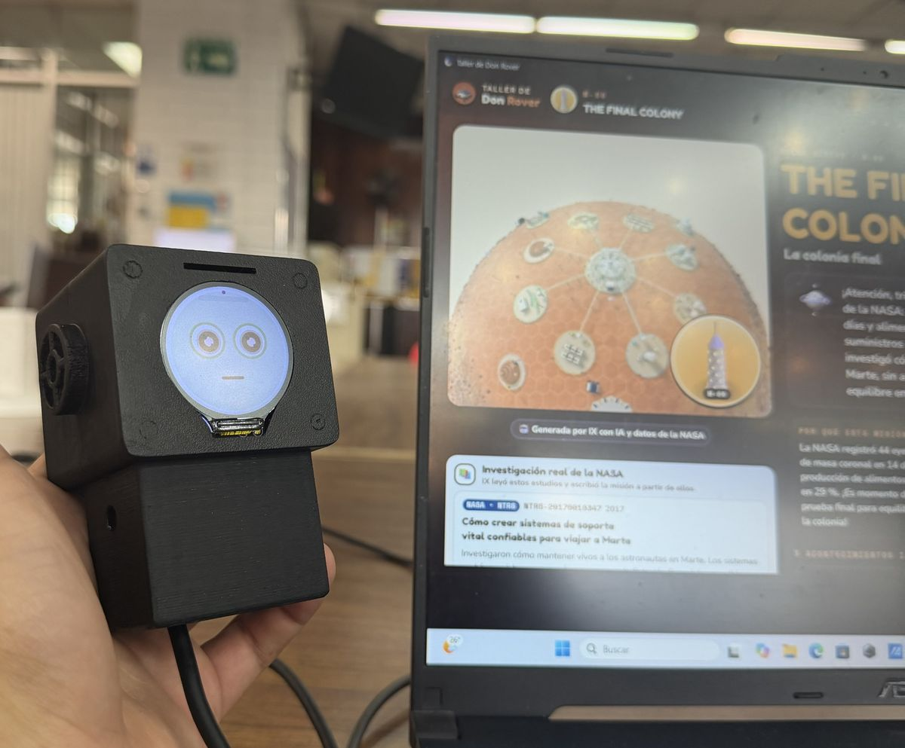

# Firmware de Don Rover · placas ESP32 con pantalla redonda

Convierte una placa ESP32 con pantalla redonda **GC9A01** (1.28″, 240 × 240) en la cara de **Don Rover**, el asistente físico del [Taller de Don Rover](../../README.md). Es un solo firmware con un entorno de PlatformIO por placa.

La placa **no tiene micrófono ni bocina**: la computadora del profe habla por sus bocinas y escucha con su micrófono. La placa muestra la cara, mueve la boca mientras Don Rover habla, cambia de expresión según la misión y dibuja el tiempo que queda como un anillo.

<p align="center">
  
</p>

## Placas

| Entorno | Placa | Chip | Flash · PSRAM | Pantalla | Luz de fondo | Botón |
| --- | --- | --- | --- | --- | --- | --- |
| `knomi` | BIGTREETECH KNOMI v1 | ESP32-WROVER-E | 16 MB · 8 MB | integrada, SPI a 80 MHz | AW9346 por pulsos (GPIO2) | BOOT (GPIO0) |
| `esp32c3-round` | ESP32-2424S012 | ESP32-C3 | 4 MB · — | integrada y táctil (CST816S), SPI a 80 MHz | PWM (GPIO3) | BOOT (GPIO9) o tocar la cara |
| `esp32-devkit` | ESP32 DevKit V1 + módulo GC9A01 | ESP32 | 4 MB · — | módulo con 8 cables, SPI a 40 MHz | PWM (GPIO22) | BOOT (GPIO0) |
| `esp32c3-mini` | ESP32-C3 SuperMini + módulo GC9A01 | ESP32-C3 | 4 MB · — | módulo con 8 cables, SPI a 40 MHz | PWM (GPIO5) | BOOT (GPIO9) |
| `esp32s3-n16r8` | ESP32-S3 DevKitC N16R8 + módulo GC9A01 | ESP32-S3 | 16 MB · 8 MB | módulo con 8 cables, SPI a 80 MHz | PWM (GPIO21) | BOOT (GPIO0) |

Los diagramas de conexión de cada placa están en el [README principal](../../README.md#diagramas-de-conexión) y en [`docs/img/hardware/`](../../docs/img/hardware/). Se generan con `python3 docs/tools/diagramas.py` (desde la raíz del repositorio).

### Pines de la pantalla (GPIO)

| Señal | Módulo | `knomi` | `esp32c3-round` | `esp32-devkit` | `esp32c3-mini` | `esp32s3-n16r8` |
| --- | :---: | :---: | :---: | :---: | :---: | :---: |
| Reloj SPI | SCL | 18 | 6 | 18 | 4 | 12 |
| Datos SPI | SDA | 23 | 7 | 23 | 6 | 11 |
| Selección | CS | 5 | 10 | 5 | 7 | 10 |
| Dato / comando | DC | 19 | 2 | 19 | 10 | 9 |
| Reinicio | RES | 4 | — (RST de la placa) | 4 | 3 | 14 |
| Luz de fondo | BLK | 2 | 3 | 22 | 5 | 21 |
| Alimentación | VCC | — | — | 3V3 | 3V3 | 3V3 |

Fuentes: KNOMI, del firmware oficial de BIGTREETECH (rama `firmware`, `src/pinout_knomi_v1.h`); ESP32-2424S012, de la definición pública de la placa ([rzeldent/platformio-espressif32-sunton](https://github.com/rzeldent/platformio-espressif32-sunton)); el táctil usa SDA 4, SCL 5 y RST 1. El DevKit usa los mismos pines que la KNOMI; en el C3 SuperMini y el S3 se eligieron pines que no deciden cómo arranca el chip.

## Instalar

**Desde el navegador (recomendado).** Abre la plataforma en Chrome o Edge → `#/donrover` → elige tu placa → *Instalar en la placa*. El instalador lee el manifiesto `public/firmware/donrover.json`, comprueba que el chip conectado sea el de la placa elegida y escribe la imagen con la herramienta oficial de Espressif (`esptool-js`).

**Desde la terminal, sin compilar** (solo necesita Python 3; detecta el chip y el puerto solos):

```powershell
# Windows (PowerShell), en esta carpeta
powershell -ExecutionPolicy Bypass -File .\flash.ps1                        # KNOMI v1
powershell -ExecutionPolicy Bypass -File .\flash.ps1 -Board esp32c3-mini    # otra placa
powershell -ExecutionPolicy Bypass -File .\flash.ps1 -Board knomi -Port COM5
```

```bash
# macOS o Linux
./flash.sh                          # KNOMI v1
./flash.sh esp32c3-mini             # otra placa
./flash.sh knomi /dev/ttyUSB0       # placa y puerto
```

Los scripts usan la imagen de `public/firmware/donrover-<placa>.bin` o, si no está, la descargan de la plataforma publicada. Si la primera vez falla, reintentan más lento (115200 baudios).

Sin clonar el repositorio (cambia `knomi` por tu placa):

```bash
python3 -m pip install esptool
curl -LO https://tallerdedonrover.vercel.app/firmware/donrover-knomi.bin
python3 -m esptool --baud 230400 write_flash -z 0x0 donrover-knomi.bin
```

**Compilando** (con [PlatformIO](https://platformio.org/install/cli)):

```bash
cd firmware/donrover-knomi
pio run                         # compila las 5 placas
pio run -e knomi -t upload      # compila e instala en una placa
pio device monitor              # ver los mensajes (115200)
```

Después de cada compilación, `merge_bin.py` une bootloader, particiones y app en una sola imagen (`public/firmware/donrover-<placa>.bin`, se escribe en `0x0`) y actualiza el manifiesto `donrover.json` (versión, tamaño y SHA-256 de cada placa). Así el instalador del navegador siempre usa la última versión. El bootloader va en `0x1000` en el ESP32 y en `0x0` en el C3 y el S3; el script lo resuelve solo.

Si la placa no entra al modo de carga: mantén presionado **BOOT**, desconecta y vuelve a conectar el cable, y suelta el botón.

## Colores, luz de fondo y táctil

- **Colores.** Los paneles IPS GC9A01 necesitan la inversión de color encendida: sin ella, la cara se ve clara y con los ojos cafés. Desde la versión **1.1.0** viene encendida (`DISPLAY_INVERT=1`). Si un módulo se ve al revés, `#/donrover` → **🎨 Invertir colores** manda `{"t":"invert"}` y la placa guarda la elección en su memoria (NVS).
- **Luz de fondo de la KNOMI.** No es PWM: es un controlador **AW9346** de un solo cable que baja un nivel por cada pulso corto (16 niveles). El firmware sigue el mismo protocolo que el firmware oficial. Las demás placas usan PWM normal.
- **Táctil.** En la ESP32-2424S012, tocar la cara (CST816S por I²C) funciona igual que el botón.
- **Memoria.** Con PSRAM, la cara se dibuja con colores de 16 bits. Sin PSRAM, el firmware usa 16 bits si hay memoria libre suficiente y, si no, 256 colores.

## Cómo se conecta con la plataforma

Tres caminos con el mismo protocolo (una línea JSON por mensaje):

| Camino | Cuándo | Detalle |
| --- | --- | --- |
| **USB** (Web Serial) | Placa conectada a la computadora del profe | 115200 baudios. Lo más confiable y con la boca mejor sincronizada. Funciona desde la plataforma publicada (HTTPS). |
| **Wi-Fi local** | Placa y computadora en la misma red | WebSocket en `ws://<ip>:81` y HTTP en el puerto 80 (`GET /status`, `POST /cmd` y la página para configurar el Wi-Fi). mDNS: `donrover.local`. Una página HTTPS no siempre puede abrir `ws://`: entonces se usa `POST /cmd` (Chrome pide permiso de *red local*) o la nube. |
| **Nube** | Placa con Wi-Fi e internet | La placa pide `<plataforma>/api/realtime` y se une al canal de Supabase Realtime `donrover-bot-<ID>`. La plataforma se conecta con el código de 6 caracteres de la placa. |

Sin Wi-Fi configurado, la placa abre la red **`DonRover-<ID>`** con una página para elegir la red (portal cautivo). También se puede configurar desde `#/donrover` por USB.

## Protocolo

Computadora → placa:

| Mensaje | Efecto |
| --- | --- |
| `{"t":"hello"}` | La placa contesta con `hi` |
| `{"t":"ping"}` | Mantiene viva la conexión (cada 4 s) |
| `{"t":"face","e":"happy","ms":3000}` | Expresión: `neutral`, `happy`, `sad`, `alert`, `think`, `wow`, `sleep`, `listen`, `star`. Con `ms` vuelve sola a la neutral. |
| `{"t":"talk","on":1}` | Habla: la boca se mueve con sílabas propias hasta `on:0` |
| `{"t":"m","v":70}` | Golpe de voz (0–100) por cada palabra que dice la computadora |
| `{"t":"look","x":-40,"y":10}` | Hacia dónde mira (−100…100) |
| `{"t":"ring","p":350,"c":"#FFC93C"}` | Anillo de progreso (0–1000; −1 lo oculta) |
| `{"t":"pulse","c":"#B69CFF"}` | Anillo que late (escuchando); `"c":""` lo apaga |
| `{"t":"card","title":"ABCD","sub":"…","ms":8000}` | Tarjeta con texto grande (título vacío la oculta) |
| `{"t":"invert","on":1}` | Inversión de color de la pantalla (se guarda en la placa) |
| `{"t":"bl","v":200}` | Brillo de la pantalla (10–255) |
| `{"t":"wifi","ssid":"…","pass":"…"}` · `{"t":"forget"}` | Guardar u olvidar el Wi-Fi |
| `{"t":"app","url":"https://…"}` | Dirección de la plataforma (para el canal en la nube) |
| `{"t":"reboot"}` | Reiniciar |

Placa → computadora:

- `{"t":"hi","fw","name","board","inv","face","id","wifi","ssid","ip","cloud","app","ap"}` al arrancar, al cambiar la red o al recibir `hello`. `board` es el entorno de la placa (por ejemplo `esp32c3-mini`) y `inv` dice si la inversión de color está encendida.
- `{"t":"btn","k":"short"}`: toque corto, Don Rover repite lo último que dijo.
- `{"t":"btn","k":"long"}`: sostenido más de 0.7 s, Don Rover escucha una pregunta.
- Si se mantiene 5 s, la pantalla muestra su código y su IP.

## Estructura

```
platformio.ini   un entorno por placa (pines, flash, PSRAM, USB nativo y táctil)
src/main.cpp     protocolo, USB, botón, táctil y ajustes guardados
src/face.cpp     cara animada (sprite de 240 × 240, ~30 cuadros por segundo) y luz de fondo
src/net.cpp      Wi-Fi, portal de configuración, WebSocket, HTTP y canal en la nube (tarea propia)
merge_bin.py     une bootloader + particiones + app y actualiza public/firmware/donrover.json
flash.ps1        instalador para Windows
flash.sh         instalador para macOS y Linux
```

La red corre en su propia tarea de FreeRTOS: la cara y el USB nunca esperan a que se conecte el Wi-Fi o la nube. El canal en la nube usa TLS sin verificar el certificado (solo viajan órdenes de la cara y la clave pública *anon*).

**Agregar otra placa:** copia un entorno de `platformio.ini` y cambia el `board`, los pines (`TFT_*`, `PIN_BACKLIGHT`, `PIN_BUTTON`), `BOARD_ID` y `custom_board_name`. Agrégala al orden de `merge_bin.py` (y su chip a `BOOTLOADER_AT` si es nuevo) y a las listas de `flash.ps1` y `flash.sh`. Al compilar con `pio run -e <entorno>`, el manifiesto la incluye y la página `#/donrover` la muestra sola.
